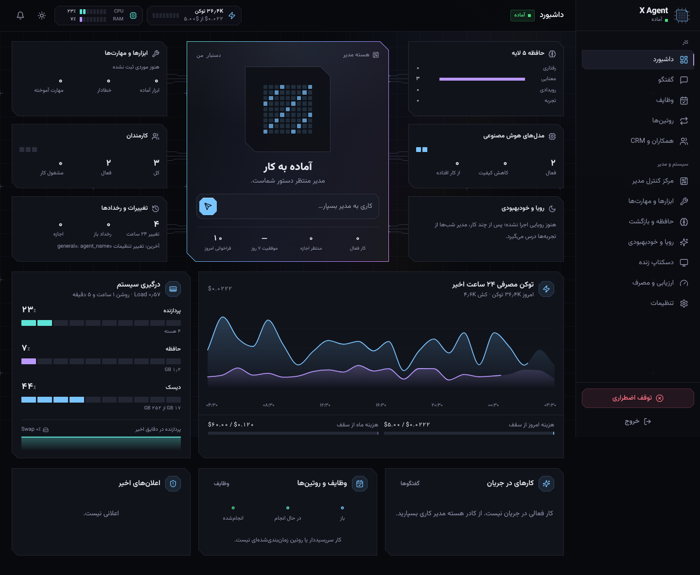
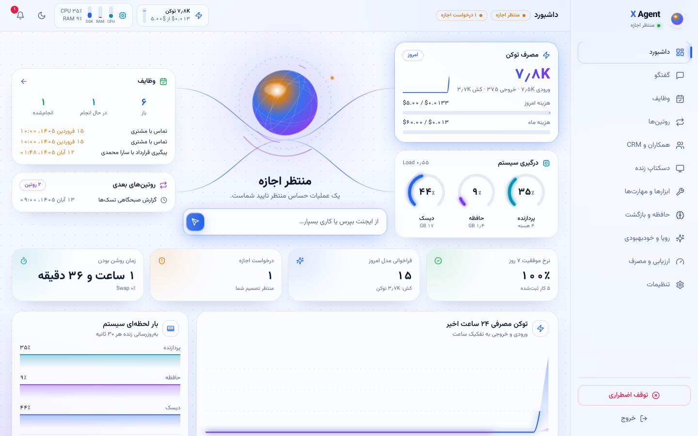
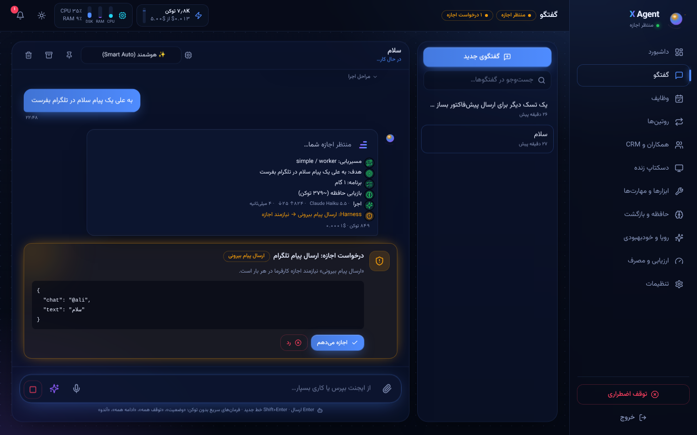
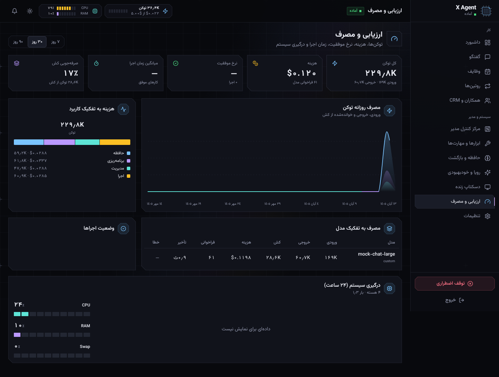
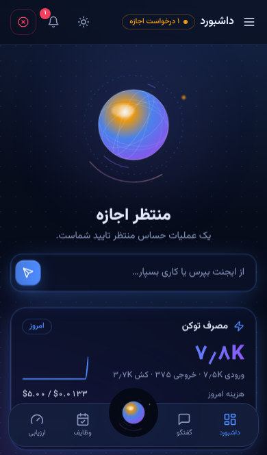
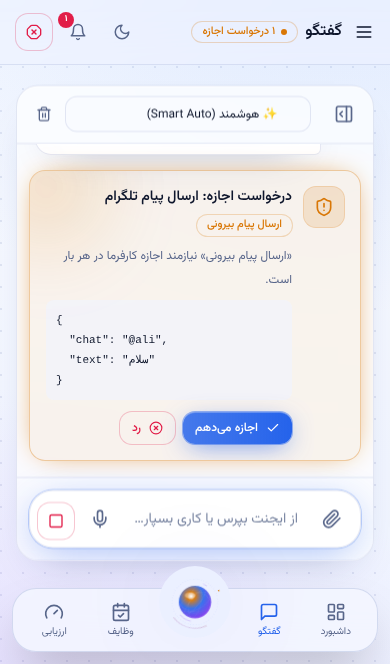
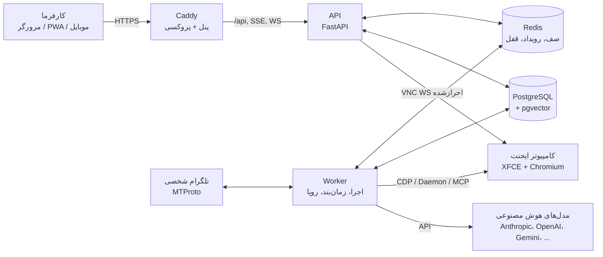

<div dir="rtl">

# X Agent — کارمند دیجیتال ۲۴ساعته شما

X Agent یک ایجنت هوش مصنوعی **خودمیزبان، فارسی و آماده استقرار** است که روی VPS شما اجرا می‌شود و وقتی گوشی و کامپیوترتان خاموش است هم به کار ادامه می‌دهد. همه کدها، حافظه‌ها، فایل‌ها، کلیدها و داده‌ها روی سرور خودتان و ۱۰۰٪ تحت مالکیت شماست.

<p align="center">
  
  
</p>
<p align="center">
  
  
</p>
<p align="center">
  
  
</p>

---

## نصب تک‌خطی

روی یک Ubuntu 24.04 خام (یا 22.04 / Debian 12):

```bash
curl -fsSL https://raw.githubusercontent.com/omerae7/Xagent/main/install.sh | sudo bash
```

با دامنه و گواهی HTTPS معتبر (Let's Encrypt):

```bash
curl -fsSL https://raw.githubusercontent.com/omerae7/Xagent/main/install.sh | sudo bash -s -- --domain agent.example.com --email you@example.com
```

برای سرورهای داخل ایران (آینه رجیستری داکر، PyPI و npm):

```bash
curl -fsSL https://raw.githubusercontent.com/omerae7/Xagent/main/install.sh | sudo bash -s -- \
  --mirror https://<آینه-داکر> --pip-index https://<آینه-pypi>/simple --npm-registry https://<آینه-npm>
```

نصاب به‌صورت خودکار:

1. سخت‌افزار را تشخیص می‌دهد (هسته‌ها، حافظه، دیسک، معماری amd64/arm64) و پروفایل `lite`، `standard` یا `performance` را انتخاب می‌کند.
2. Swap (پیش‌فرض ۸ گیگابایت در صورت فضای کافی)، Docker و Compose، فایروال UFW (فقط SSH، 80 و 443) را تنظیم می‌کند.
3. اسرار تصادفی (کلید رمزنگاری، رمز دیتابیس، توکن دسکتاپ) می‌سازد و فایل `.env` را فقط برای root قابل خواندن می‌کند.
4. ایمیج‌ها را می‌سازد، سرویس‌ها را اجرا و سلامت آن‌ها را بررسی می‌کند.
5. سرویس به‌روزرسانی امن (systemd) و دستور مدیریتی `xagent` را نصب می‌کند.
6. نشانی پنل، نام کاربری `admin` و **رمز اولیه** را نمایش می‌دهد (در `/opt/xagent/data/initial_password.txt` هم ذخیره است).

| گزینه | توضیح |
|---|---|
| `--domain` / `--email` | دامنه و ایمیل ACME؛ بدون دامنه، HTTPS با گواهی داخلی روی IP |
| `--profile lite\|standard\|performance` | انتخاب دستی پروفایل منابع |
| `--no-desktop` / `--with-desktop` | خاموش/روشن کردن کامپیوتر ایجنت (دسکتاپ گرافیکی) |
| `--swap 8` | اندازه Swap به گیگابایت |
| `--mirror` / `--pip-index` / `--npm-registry` | آینه‌ها برای شبکه‌های محدود |
| `--timezone Asia/Tehran` | منطقه زمانی پیش‌فرض |

### پروفایل‌های سخت‌افزاری (اجرا روی هر سخت‌افزاری)

| پروفایل | شرط خودکار | دسکتاپ | تنظیمات |
|---|---|---|---|
| `lite` | کمتر از ۴ گیگ RAM | خاموش (فعال‌شدنی) | Postgres 128MB، یک اجرای هم‌زمان، جاسازی محلی |
| `standard` | ۴ تا ۱۵ گیگ (هدف: ۴ هسته / ۸ گیگ) | روشن | Postgres 512MB، ۳ اجرای هم‌زمان |
| `performance` | ۱۵ گیگ به بالا و ۶ هسته | روشن (Full HD) | Postgres 2GB، ۶ اجرای هم‌زمان، ۴ Worker برای API |

به GPU نیاز نیست؛ مدل‌ها از طریق API ابری (یا Ollama محلی) فراخوانی می‌شوند. جاسازی متنی (Embedding) به‌صورت پیش‌فرض **محلی و رایگان** است تا روی ضعیف‌ترین سرور هم کار کند.

### مدیریت روی سرور

دستور `xagent` در مسیر ثابت `/usr/local/lib/xagent` نصب می‌شود (پیوند در `/usr/local/bin/xagent`) و به پوشه برنامه یا فایل موقت وابسته نیست.

```bash
xagent status                 # وضعیت سرویس‌ها و آخرین به‌روزرسانی
xagent version                # نسخه فعلی و قبلی
xagent doctor                 # بررسی دیسک، Docker، تغییرات محلی و سلامت
xagent logs worker            # لاگ زنده
sudo xagent update            # به‌روزرسانی امن (همان دکمه پنل)
sudo xagent update --dry-run  # فقط نمایش تغییرات نسخه بعد
sudo xagent rollback          # بازگشت به نسخه قبلی (و Schema قبلی در صورت نیاز)
xagent backup                 # پشتیبان دیتابیس
xagent restore <file>         # بازگردانی (دیتابیس فعلی با نام دیگر نگه داشته می‌شود)
xagent password admin         # بازنشانی رمز کارفرما
sudo xagent desktop on|off    # روشن/خاموش کردن کامپیوتر ایجنت
```

### به‌روزرسانی امن با یک دستور: `xagent update`
۱. قفل (جلوگیری از اجرای هم‌زمان) و تشخیص نسخه نصب‌شده و منبع معتبر (`XAGENT_REPO_URL`)
۲. پیش‌بررسی Docker، فضای دیسک (حداقل ۴ گیگ) و سلامت سرویس فعلی
۳. دریافت نسخه هدف و بررسی اینکه ادامه مستقیم نسخه فعلی است (Downgrade فقط با `--allow-downgrade`)
۴. **حفظ تغییرات محلی:** هیچ `git reset --hard` اجرا نمی‌شود؛ تغییرات در `backups/local-changes-*.patch` و `git stash` نگه داشته و فایل‌های ردیابی‌نشده اپراتور پس از به‌روزرسانی برگردانده می‌شوند
۵. پشتیبان دیتابیس (`pg_dump` + اعتبارسنجی) و پیکربندی/اسرار (`.env`، `data/control`)
۶. ساخت ایمیج‌های نسخه جدید با تگ همان Commit در پوشه جدا (`releases/<commit>`)؛ سرویس فعلی تا این لحظه دست‌نخورده است
۷. آزمون دود ایمیج و **آزمون Migration روی کپی دیتابیس**؛ شکست = توقف بدون هیچ تغییری
۸. استقرار، بررسی سلامت API/DB/Redis، ضربان Worker و پنل
۹. شکست پس از استقرار = **Rollback خودکار** تگ ایمیج و در صورت اجرای Migration، بازیابی مرحله‌ای دیتابیس از پشتیبان (دیتابیس تغییریافته حذف نمی‌شود)
۱۰. گزارش نسخه قبلی/جدید، نتیجه آزمون‌ها و مسیر پشتیبان؛ `version.json` برای `xagent rollback`

دکمه به‌روزرسانی پنل همان مسیر را اجرا می‌کند (فایل درخواست ← سرویس systemd میزبان ← `xagentctl update --yes`) و گزارش زنده در پنل دیده می‌شود.

### مهاجرت یک‌باره سرورهای قدیمی (بدون دستور `xagent` یا با به‌روزرسان قدیمی)
```bash
curl -fsSL https://raw.githubusercontent.com/omerae7/Xagent/main/infra/updater/bootstrap.sh | sudo bash -s -- --ref main
```
این اسکریپت پوشه برنامه را تغییر نمی‌دهد؛ فقط ابزارهای مدیریتی را از نسخه هدف (با `git show`) در مسیر ثابت نصب می‌کند، سرویس systemd را به‌روز می‌کند و سپس `xagent update` را اجرا می‌کند. برای نصب بدون به‌روزرسانی: `--no-update`.

---

## شروع کار پس از نصب

1. وارد پنل شوید و از **تنظیمات ← امنیت** رمز را تغییر دهید.
2. **تنظیمات ← هوش مصنوعی ← افزودن مدل**: شرکت (Anthropic، OpenAI، Google، OpenRouter، DeepSeek، Groq، xAI، Mistral، Ollama یا هر API سازگار) ← کلید API ← نام مدل ← تست اتصال ← روشن/خاموش.
3. حالت **اسمارت** را انتخاب و تا ۳ مدل «مدیر» و ۳ مدل «کارمند» (با ترتیب Fallback) تعیین کنید؛ یا در حالت **حرفه‌ای** برای هر بخش (مدیریت، هدف‌سنجی، برنامه‌ریزی، اجرا، چشم، گوش/صدا، حافظه، ارزیابی، رویا) مدل جدا انتخاب کنید.
4. در **تنظیمات ← مجوزها (Harness)** برای هر دسته عملیات حالت «خودکار / با اجازه / مشروط / ممنوع» و قانون متنی اختصاصی بنویسید.
5. (اختیاری) **تنظیمات ← تلگرام**: با API ID/Hash از my.telegram.org و شماره خودتان وارد شوید. برای فرمان دادن به ایجنت در «Saved Messages» خودتان پیام بدهید.

---

## قابلیت‌ها

### چرخه کامل اجرای هر کار
`دریافت ← دسته‌بندی و مسیریابی ← هدف‌سنجی ← برنامه‌ریزی ← حافظه و ابزار گزینشی ← اجرا ← مشاهده ← اعتبارسنجی ← بازیابی یا پایان ← یادگیری (با Undo)`

- **رویدادمحور و قطعی‌اول:** پیام‌های تلگرام، روتین‌ها و فرمان‌های سریع («وضعیت»، «توقف همه»، «ادامه همه»، «آندو») بدون صدا زدن مدل پردازش می‌شوند. مدل فقط وقتی فراخوانی می‌شود که درک معنایی یا برنامه‌ریزی لازم باشد.
- **مسیریاب سبک:** کار ساده و کم‌ریسک مستقیم به مدل کارمند می‌رود؛ کار چندمرحله‌ای، مبهم یا حساس به مدیر.
- **Checkpoint کامل:** وضعیت هر اجرا پس از هر گام ذخیره می‌شود؛ ری‌استارت Worker، انتظار برای اجازه یا توقف Stop-Loss کار را از بین نمی‌برد.

### پنل مدیریت فارسی (RTL، PWA، تاریک/روشن، موبایل و دسکتاپ)
۱۲ بخش کاملاً متصل به API با زبان طراحی «سیلیکون زنده» ([`DESIGN.md`](DESIGN.md)): داشبورد (**نقشه زنده تراشه ایجنت**: هسته مدیر و بلوک‌های حافظه، ابزار، مدل‌ها، کارمندان، رویا و تغییرات با مسیرهای سیگنال که با فعالیت واقعی روشن می‌شوند؛ مصرف توکن و **درگیری سیستم CPU/RAM/دیسک** زنده)، **مرکز کنترل مدیر** (کارمندان، تاریخچه همه تغییرات با قبل/بعد و دکمه بازگرداندن، عیب‌یابی و خوددرمانی، سلامت و قابلیت آزمون‌شده مدل‌ها)، گفتگو (مراحل زنده، کارت اجازه، پیوست، صدا، **مکالمه صوتی زنده**، انتخاب مدل)، وظایف (لیست، کانبان، **تقویم شمسی**)، روتین‌ها، CRM، دسکتاپ زنده (Takeover)، ابزارها و نصب از GitHub، حافظه و مرکز Undo، رویا، ارزیابی و مصرف، تنظیمات.

ظاهر پنل کاملاً مبتنی بر **Design Token** است (بدون گوی/دایره؛ بلوک‌های پَخ‌دار، پدهای مربعی و درخشش لایه نازک فقط برای بخش‌های فعال) ([`apps/web/src/styles/tokens.css`](apps/web/src/styles/tokens.css))؛ با تغییر همین فایل ظاهر با هر تصویر مرجعی هماهنگ می‌شود، بدون دست زدن به منطق.

### حافظه ۵ لایه با بودجه‌بندی توکن
| لایه | ذخیره‌سازی | نحوه استفاده |
|---|---|---|
| چت (Working RAM) | پیام‌ها + خلاصه فشرده | فقط پنجره اخیر تا سقف بودجه؛ نکات مهم کارفرما پس از بررسی تعارض به حافظه پایدار منتقل می‌شوند |
| رفتاری | قوانین با اولویت و نسخه | همیشه (به ترتیب اولویت، تا سقف بودجه). **فقط کارفرما** می‌تواند قانون ثبت کند (Anti-Injection) |
| معنایی | دو بخش «X Agent» و «کارفرما/کسب‌وکار/همکاران» | جست‌وجوی ترکیبی SQL + تمام‌متن فارسی + برداری |
| رویدادی | سابقه ساختاریافته همه کارها | **هرگز در کارهای عادی خوانده نمی‌شود**؛ فقط با کوئری فیلترشده. حذف آن در سطح دیتابیس مسدود است |
| تجربی (برداری) | روش‌های موفق/ناموفق با آمار توکن | قبل از کار مشابه، کم‌هزینه‌ترین روش تاییدشده بازیابی می‌شود |

### Snapshot، Undo و پاکسازی خودکار یادگیری مضر
هر تغییر در حافظه رفتاری، معنایی، تجربی، مهارت‌ها و ابزارها یک `Revision` با نسخه قبلی و دلیل تغییر دارد. یادگیری‌های جدید ابتدا **آزمایشی** هستند و اگر در اجراهای بعدی باعث خطا یا افزایش توکن شوند، ارزیاب به‌طور خودکار آن‌ها را برمی‌گرداند. کارفرما از پنل یا با پیام «آندو» هر یادگیری را فوراً پاک می‌کند (Undo آبشاری تغییرات وابسته را هم برمی‌گرداند).

### Harness و مدیریت سه‌لایه حلقه
- ماتریس مجوز قطعی سمت سرور برای: لاگین، حذف/ویرایش فایل، پیام بیرونی، نصب ابزار، تغییر روتین/تسک، پرداخت، اجرای کد، کنترل دسکتاپ، تغییر حافظه، ابزارهای خارجی و به‌روزرسانی هسته؛ هر کدام با **باکس قانون متنی** و شروط ساختاریافته (فهرست مجاز/حساس، عملیات نیازمند اجازه). پرداخت و تغییر هسته هرگز خودکار نمی‌شوند.
- **کنترلر تطبیقی:** تکرار اقدام یا خطای پیاپی ← تغییر استراتژی ← ارتقا به مدل مدیر ← توقف کنترل‌شده.
- **Stop-Loss قطعی:** سقف هزینه/توکن هر تسک، سقف روزانه/ماهانه، سقف گام (تطبیقی) و زمان اجرا؛ با ذخیره وضعیت و دکمه «ادامه».
- **مدارقطع‌کن و قفل اتمیک روتین‌ها** (Redis Lease + TTL) و توقف اضطراری سراسری `STOP_ALL`.

### ابزارها
۳۳ ابزار داخلی (حافظه، سابقه کارها، فایل، فرمان ایزوله، تسک، روتین، CRM، وب، مرورگر ساختاریافته Playwright، کنترل تصویری دسکتاپ، تلگرام، نصب ابزار) + **نصب ابزار از GitHub، npm، PyPI یا نشانی سرور MCP** با تست در محیط ایزوله، نسخه‌بندی، به‌روزرسانی، غیرفعال‌سازی و Rollback. ترتیب انتخاب: API/MCP ← مرورگر ساختاریافته ← کنترل تصویری.

### کامپیوتر اختصاصی ایجنت
کانتینر لینوکس XFCE با Chromium (پروفایل پایدار، لاگین‌ها حفظ می‌شوند) و Telegram Desktop. فقط از پشت احراز هویت پنل قابل مشاهده است؛ با «در دست گرفتن کنترل» اقدامات خودکار ایجنت در دو لایه (Redis و دیمن دسکتاپ) متوقف می‌شود.

### رویا (Dream)
اجرای شبانه در ساعت قابل تنظیم (به وقت ایران)، **افزایشی** از آخرین Checkpoint و **بدون مصرف LLM** اگر رویداد مهمی نبود؛ تقطیر مهارت‌ها (با تست قطعی)، به‌روزرسانی دانسته‌های ایجنت، علامت‌گذاری روش‌های منسوخ و پاکسازی فقط کش موقت.

---

## معماری



- **Modular Monolith:** `packages/core` (پیکربندی، مدل‌ها، امنیت، رویداد)، `packages/agent_core` (ارائه‌دهندگان، مسیریاب، Harness، Stop-Loss، چرخه اجرا، رویا)، `packages/memory`، `packages/tools`، `packages/crm`؛ سرویس‌های `services/api` و `services/worker`؛ پنل `apps/web`.
- فقط پورت‌های 80/443 منتشر می‌شوند. دیتابیس و Redis روی شبکه `internal` بدون دسترسی اینترنت هستند.
- جزئیات بیشتر: [`docs/ARCHITECTURE.md`](docs/ARCHITECTURE.md)

### ساختار مخزن
```
apps/web/              پنل React + Vite + Tailwind (RTL، PWA)
services/api/          FastAPI، Migrationهای Alembic
services/worker/       اجراکننده، زمان‌بند، صندوق رویداد، تلگرام، رویا
packages/core/         پیکربندی، اسکیمای دیتابیس، امنیت، Redis
packages/agent_core/   ارائه‌دهندگان مدل، مسیریاب، Harness، Stop-Loss، چرخه اجرا
packages/memory/       حافظه ۵ لایه، جاسازی، Undo
packages/tools/        ابزارها، محیط ایزوله، MCP، نصاب GitHub
packages/crm/          همکاران، پروژه‌ها و سوابق
infra/                 Dockerfileها، Caddy، دسکتاپ، به‌روزرسان، xagentctl
install.sh             نصاب تک‌خطی
compose.yaml           استقرار کامل
tests/                 تست‌های واحد، حافظه، انتهابه‌انتها و ابزار
```

---

## امنیت

- رمز عبور با **Argon2id**، نشست با JWT در کوکی `httpOnly` + `SameSite=Strict` و هدر ضد CSRF؛ قفل موقت پس از ورودهای ناموفق.
- کلیدهای API و نشست تلگرام با **Fernet** رمزنگاری می‌شوند و هرگز به پنل بازگردانده نمی‌شوند.
- لاگ حسابرسی و حافظه رویدادی با **Trigger دیتابیس** غیرقابل حذف/ویرایش هستند.
- کد شخص ثالث (ابزارهای GitHub و سرورهای MCP) داخل کامپیوتر ایجنت اجرا می‌شود که هیچ رمز یا کلیدی ندارد؛ در حالت سبک، با محیط حداقلی و محدودیت منابع.
- محتوای وب، فایل‌ها و پیام اشخاص ثالث به‌صورت «داده نامطمئن» علامت می‌خورد و نمی‌تواند قوانین رفتاری، مجوزها یا حافظه را تغییر دهد.
- جلوگیری از SSRF در ابزارهای وب (عدم دسترسی به شبکه داخلی).
- به‌روزرسانی هسته بدون دادن سوکت داکر به کانتینرها: پنل فقط یک فایل درخواست می‌نویسد و سرویس systemd میزبان پس از پشتیبان‌گیری به‌روزرسانی می‌کند و در صورت شکست به نسخه قبل برمی‌گردد.
- **پاک‌سازی اسرار:** پیام خطای ارائه‌دهندگان، `last_error` مدل، رخدادها، خطای اجرا، پاسخ‌های خطای API و همه لاگ‌ها از کلیدها و توکن‌ها پاک می‌شوند (الگوهای شناخته‌شده + مقدار دقیق هر کلید رمزگشایی‌شده)؛ با آزمون خودکار.
- **مدیر خودگردان با مرز امنیتی:** مدیر تنظیمات مدل، ابزار، کارمند، حافظه و مسیریابی را خودش تغییر و آزمون می‌کند و همه با قبل/بعد ثبت و قابل بازگشت‌اند؛ اما تنظیمات امنیت، احراز هویت، Harness، کلید/آدرس ارائه‌دهنده، افزایش مجوز خود، پرداخت و تغییر هسته فقط با اجازه کارفرما.

---

## توسعه و تست

پیش‌نیاز: Python 3.12، Node 22، PostgreSQL 16 با pgvector و Redis 7.

```bash
uv venv .venv && uv pip install --python .venv/bin/python -r pyproject.toml --extra dev
createdb xagent_test   # کاربر/رمز پیش‌فرض تست: xagent/xagent
.venv/bin/python -m pytest tests -q
.venv/bin/ruff check .

cd apps/web && npm install && npm run build      # یا npm run dev (پروکسی /api به 127.0.0.1:8000)
```

تست‌ها روی PostgreSQL و Redis واقعی اجرا می‌شوند و فقط مدل هوش مصنوعی با یک سرور شبیه‌ساز سازگار با OpenAI جایگزین می‌شود. پوشش شامل: چرخه کامل انتهابه‌انتها، Harness و کارت اجازه، Stop-Loss و ادامه، توقف اضطراری، کنترلر حلقه، حافظه و Undo و Auto-Rollback، نصب واقعی سرور MCP از git + به‌روزرسانی + Rollback، زمان‌بند و مدارقطع‌کن، پردازش رویداد بدون LLM و پل MCP دیمن دسکتاپ.

---

## وضعیت و محدودیت‌های فعلی (گزارش صادقانه)

- ✅ ۶۳ تست خودکار (Backend، مدیر خودگردان، امنیت و نشت اسرار، ماندگاری، ابزار) + آزمون انتهابه‌انتهای `xagent update` روی استک واقعی Docker (`tests/updater/e2e.sh`: مهاجرت bootstrap، Migration خراب، نسخه ناسالم با Rollback خودکار، به‌روزرسانی موفق با حفظ داده و تغییرات محلی، Rollback دستی، نبود اسرار در گزارش) که در CI هم با ساخت کامل ایمیج‌ها اجرا می‌شود.
- ⚠️ اتصال‌دهنده‌های Anthropic، OpenAI و Gemini مطابق مستندات رسمی نوشته شده‌اند اما در محیط توسعه با **کلید واقعی** تست نشده‌اند؛ پس از افزودن کلید، دکمه «تست اتصال» در پنل صحت آن را نشان می‌دهد.
- ⚠️ تلگرام شخصی (Telethon) و حالت مکالمه صوتی زنده به حساب تلگرام واقعی و مدل‌های STT/TTS نیاز دارند و در این مرحله به‌صورت زنده تست نشده‌اند.
- ⚠️ نصاب `install.sh` از نظر نحوی و منطق بررسی شده و اجزای آن (ساخت ایمیج‌ها و اجرای compose) تست شده‌اند، اما اجرای کامل آن روی یک VPS خام هنوز انجام نشده است.
- Chromium داخل کانتینر دسکتاپ با `--no-sandbox` اجرا می‌شود (محدودیت معمول کانتینرها)؛ ایزوله‌سازی در سطح کانتینر انجام می‌شود.
- واتساپ و اینستاگرام در این نسخه ابزار اختصاصی ندارند؛ معماری ماژولار اجازه می‌دهد از طریق API رسمی/MCP (نصب از GitHub) یا مرورگر با پروفایل پایدار اضافه شوند.

</div>
