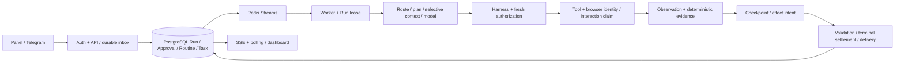

# گزارش فارسی پیگیری Codex: مرورگر پایدار، ادامه تأیید و یکپارچگی اجرا

تاریخ: ۲۰۲۶-۱۱-۰۵. مخزن: https://github.com/omerae7/Xagent؛ شاخه موجود: `ccr-345833d2-sca9ob`؛ PR موجود: [#2](https://github.com/omerae7/Xagent/pull/2)، Draft.

## ۱. ارزیابی اجرایی و دامنه واقعی

این دور **پیاده‌سازی** است. خط مبنای راه دور و PR در آغاز `4da35815352efd32afae85a7c404d912df7857ac` بود. checkout محلی تمیزِ `bc79cc7` پس از Fetch فقط Fast-forward شد. هیچ Reset، شاخه جایگزین، Merge به main، Force-push، استقرار یا دسترسی به VPS انجام نشد. هیچ حساب واقعی، پیام بیرونی، داده تولید یا API مدل پولی استفاده نشد.

قضاوت‌های مستقل:

| پرسش | نتیجه مبتنی بر شواهد |
|---|---|
| ساختار پایه سالم است؟ | بله، برای ادامه تکامل: PostgreSQL مرجع وضعیت، صف Redis، دفتر مصرف، Harness، Checkpoint و رجیستری ابزار قابل استفاده‌اند. بازنویسی توجیه ندارد. |
| آماده staging کنترل‌شده است؟ | در محیط ایزوله و با حساب ساختگی، پس از CI همین Commit و بررسی محدودیت‌های این گزارش؛ تأیید عملیاتی تولید نیست. |
| خودمختاری عملکردی دارد؟ | گردش واقعی ابزار، تأیید/ادامه، مرورگر، روتین و تسویه در محلی اثبات شد؛ کیفیت عمومی تصمیم‌گیری با مدل‌های واقعی اثبات نشده است. |
| زمان‌بندی قابل اتکاست؟ | آزمون‌های PostgreSQL/Redis، ساعت مجازی و سناریوی مرورگر پنج‌دقیقه‌ای موفق‌اند؛ دوام ۲۴/۷ و اختلال‌های VPS هنوز تأیید نشده‌اند. |
| آماده کار بدون نظارت است؟ | **خیر**؛ شبکه مرورگر، اختیار دسکتاپ مشترک، مهاجرت اسرار، اثرهای بیرونی عمومی و یکپارچه‌سازی زنده محدودیت دارند. |

ممیزی متادیتا/AST کل فایل‌های tracked با بازبینی عمیق همه خطوط یکسان نیست. فهرست `codex-followup-inventory.csv` پوشش ۲۸۳ فایل tracked در Commit کد را نشان می‌دهد. مسیرهای تغییرکرده و آزمون‌های رگرسیون عمیق‌تر بررسی شدند. درباره بخش‌هایی که فقط source/test بررسی شدند ادعای تأیید زنده نمی‌شود. این گزارش جایگزین ادعای «همه چیز اصلاح شد» نیست.

## ۲. معماری و مالکیت وضعیت



`AgentRunner.execute` از Run و Lease شروع می‌کند؛ `_execute` ابزارهای مجاز و context را می‌سازد؛ `_process_calls` مجوز جاری، اثر و نتیجه را مدیریت می‌کند. `_finalize` وضعیت، Task/Run، تجربه و تحویل را ثبت و **فقط ادعای تعامل مرورگر** را رها می‌کند. Scheduler موعد را در PostgreSQL claim می‌کند؛ enqueue پس از Commit انجام می‌شود و reconciliation مسیر بازیابی است. exactly-once برای اثرهای عمومی بیرونی ادعا نمی‌شود. `effect_intents` و outbox تلگرام، پیامد مبهم را از تکرار کورکورانه جدا می‌کنند.

مالکیت‌ها: PostgreSQL برای Run/Approval/Routine/Task/Mission؛ Redis برای صف و Lease و Takeover؛ مرورگر برای DOM/تب و profile؛ فایل رمزشده برای cookie/LocalStorage کارمند؛ دفتر مستقل Usage برای رزرو و هزینه. صف، پایگاه داده و سرویس بیرونی یک تراکنش مشترک ندارند.

مرورگر شش عمر مستقل دارد: process، context/identity، tab، Run، interaction lease و authentication state. Run پایان می‌یابد؛ tab و profile عادی باقی می‌مانند. فقط عملیات صریح `browser_close` می‌تواند تب انتخاب‌شده را ببندد و نیازمند Harness است.

## ۳. یافته‌های تازه و اصلاحات

### C01 — P1 — بسته‌شدن تب پس از پاسخ نهایی

- **مکان:** `packages/tools/xagent_tools/builtin/computer.py`، `_page`، `release_session`؛ `pipeline._finalize`.
- **ریشه/محرک:** `_finalize` در پایان Run، `release_session(run.id)` را صدا می‌زد؛ صفحه تازه‌ای که adopted نبود بسته می‌شد. عمر تب به Run گره خورده بود.
- **بازتولید:** Chromium واقعی + HTTP محلی: بازکردن editor → پایان Run → `page.is_closed()==True`. شاهد منفی در بخش ۷ نگهداری شده است.
- **اصلاح:** حفظ تب/هویت؛ رهاکردن ادعای Run و Lease؛ reuse بر اساس host در context مجاز؛ آوردن تب به جلو؛ target ID پایدار CDP در checkpoint؛ Lease مجزای Redis برای جلوگیری از claim هم‌زمان همان target توسط دو Worker؛ بستن صریح جداگانه.
- **سیاست منابع:** حداکثر ۴ claim فعال محلی و ۱۲ تب در هر identity. در ظرفیت، ایجاد تب جدید با خطای قابل مشاهده متوقف می‌شود؛ تب معنی‌دار، user-owned، pinned یا فعال به‌صورت سنی حذف نمی‌شود. تب موجود قابل reuse است. صفحه agent-created پس از بسته‌شدن صریح metadata خود را پاک می‌کند. این سیاست عمداً محافظه‌کارانه است؛ cleanup خودکار تب‌های دارای محتوا پیاده نشده است.
- **آزمون/پذیرش:** صفحه و draft پس از پایان/پاسخ باقی می‌مانند؛ ۸ Run متوالی همان تب را reuse می‌کنند؛ reconnect target/draft را بازیابی می‌کند؛ claim دیگر مسدود و پس از release آزاد می‌شود؛ جداسازی هویت F05 باقی است. `tests/test_followup_browser_continuity.py` و `test_master_browser.py`.
- **ریسک:** target خصوصی incognito پس از قطع CDP ممکن است از بین برود؛ cookie/LocalStorage ذخیره‌شده بازیابی می‌شود، ولی تب و SessionStorage آن تضمین نمی‌شود. هدف گم‌شده fail-closed است؛ ارسال حساس کورکورانه بازپخش نمی‌شود. TTL ادعای تب ۳۶۰ ثانیه است و پیش از هر عملیات تمدید می‌شود؛ ابزار در حال اجرا حداکثر ۳۰۰ ثانیه دارد.
- **وابستگی/مهاجرت:** Redis موجود؛ تغییر Schema ندارد. ریسک رگرسیون متوسط، چون قرارداد عمدی عمر تب عوض شده است.

### C02 — P1 — تأیید صادرشده برای عملیات تشدیدشده در زمان اجرا نامعتبر می‌شد

- **مکان:** `pipeline._process_calls`، `_approval_args`، `_binding`، `_harness_decide`، `_authorize_effect`؛ `computer._enforce_category` و `browser_type`.
- **ریشه:** درخواست EscalateCategory با `{**args, **extra_args}` امضا می‌شد؛ در ادامه `_authorize_effect` فقط `args` اصلی را مقایسه می‌کرد. اطلاعات DOM همچنین می‌توانست نام آرگومان اصلی را overwrite کند. مجوز درست صادر می‌شد ولی اثر اجرا نمی‌شد.
- **شاهد:** اجرای engine دقیق `4da3581` در process آزمون مجزا، با حفظ صفحه فقط برای مشاهده: پس از Approve، مقدار input همچنان `''` بود؛ انتظار `synthetic payload` شکست خورد. رکوردهای تولید مالک بررسی نشدند؛ فقط سازوکار با داده ساختگی اثبات شد.
- **اصلاح:** امضای یکنواخت روی دو بخش جدا: operation اصلی + scope مشاهده‌شده اثر. scope برای هر call/category در checkpoint نگهداری می‌شود؛ Run، employee، نام ابزار، دسته و آرگومان‌ها همچنان HMAC-bound هستند. قبل از اثر، URL و مشخصات DOM دوباره با scope مقایسه می‌شوند. تغییر واقعی هدف، آرگومان، call ID یا مجوز باعث مسدودشدن می‌شود؛ کنترل امنیتی حذف نشده است.
- **انقضا/لغو:** اجازه منقضی‌شده برای عملیات منطبق کارت تازه ایجاد می‌کند و رکورد منقضی محفوظ می‌ماند؛ denied/revoked اجرا نمی‌شوند. مرحله «اجازه تأیید شد؛ ادامه عملیات» و علت دقیق mismatch/policy/revocation در timeline ثبت می‌شود.
- **تفکیک typing/submission:** fill معمولی پس‌شرط واقعی مقدار فیلد دارد؛ ورود password همچنان login می‌خواهد. Enter از روی فرم واقعی می‌تواند external_message/payment/web_irreversible شود؛ جست‌وجو صرفاً به دلیل تایپ حساس نمی‌شود. برای اثبات ارسال، `expect_text` اختیاریِ افزوده‌شده باید رسید **تازه، دقیق و visible** را مشاهده کند. نبود/وجود قبلی رسید، موفقیت ارسال نیست. DOM فقط رسید رابط است، نه اثبات مستقل بانک یا سرویس گیرنده.
- **آزمون:** فرم واقعی Chromium؛ approve/reconnect/deny/revoke/expiry/changed arguments/changed call ID، مشاهده field و یک submission، duplicate execution بدون اثر دوم. تغییر DOM بعد از درخواست مجوز مسدود می‌شود. جداسازی Run در query و امضا حفظ شده است.
- **پذیرش:** همان عملیات مصوب اجرا و مشاهده شود، یا دلیل دقیق عدم اجرا ثبت شود؛ اجازه هرگز شاهد انجام کار نیست.
- **ریسک/سازگاری:** آرگومان جدید اختیاری است؛ scope قدیمیِ مبهم گسترش نمی‌یابد. تأییدهای تشدیدشده‌ای که قبل از اصلاح با امضای ناسازگار ذخیره شدند ممکن است نیازمند درخواست تازه باشند. event listenerهای دلخواه JavaScript و effectهای خام GUI فقط از روی DOM قابل اثبات نیستند؛ این محدودیت مرز امنیت مرورگر است.

### C03 — P2 — اجرای دوباره پیام Run پایانی به MissingGreenlet می‌رسید

- **مکان:** `pipeline.AgentRunner.execute`، شاخه terminal/missing/waiting.
- **ریشه:** `rollback()` attributeهای ORM را expire می‌کرد؛ سپس `run.status` به lazy I/O در context نامناسب می‌رفت.
- **بازتولید:** فراخوانی execute پس از Run موفق در آزمون فرم، خطای واقعی `sqlalchemy.exc.MissingGreenlet`.
- **اصلاح:** ذخیره status پیش از rollback؛ هیچ ابزار یا اثر قبلی دوباره اجرا نمی‌شود.
- **پذیرش/آزمون:** delivery/execute تکراری روی Run پایانی، همان status و یک اثر. Schema ندارد؛ ریسک پایین.

### C04 — P1 — تصمیم‌های تأیید هم‌زمان بدون serialization تراکنش

- **مکان:** `xagent_core.approvals.decide`.
- **ریشه بازتولیدشده:** refresh ساده قفل نبود؛ دو callback می‌توانستند pending ببینند. دو کارت یک Run نیز می‌توانستند هر کدام کارت دیگر را pending ببینند و wake-up نهایی را از دست بدهند. Run پایانی هم بدون شرط requeue می‌شد.
- **اصلاح:** ترتیب ثابت قفل Run سپس Approval، تازه‌خوانی رکورد و transition فقط waiting_approval→queued؛ revoke فقط Approval را قفل می‌کند تا پشت قفل Run در حال اجرا نماند.
- **آزمون:** بازپخش service دقیق baseline روی PostgreSQL: هر ۵ کنترل duplicate callback/distinct cards/سه terminal status شکست خوردند؛ نسخه اصلاح‌شده موفق است. deny/revoke/expiry نیز آزموده شدند. `tests/test_followup_approval_transactions.py`.
- **پذیرش:** یک تصمیم committed و یک wake-up نهایی؛ terminal Run بازصف نشود؛ revoke حین اجرا همچنان به‌موقع خوانده شود. صف Redis و Commit اتمیک نیستند؛ reconciliation موجود همچنان لازم است. ریسک متوسط؛ Migration ندارد.

### C05 — P1 — پاسخ پروتکل MCP به‌اشتباه verified بود

- **مکان:** `registry._mcp_tool` و `mcp_client.list_tools`.
- **شاهد منفی:** دو پاسخ موفق پروتکل با ابزار mutating/unknown مقدار `verified=True` داشتند؛ دو رگرسیون شکست خوردند.
- **اصلاح:** annotations واقعی SDK حفظ می‌شوند. readOnlyHint صریح بدون destructiveHint می‌تواند observation خواندنی باشد؛ unknown/write به‌صرف موفقیت پروتکل verified نمی‌شود. Harness و رابط ToolResult حفظ شده‌اند.
- **پذیرش:** write بدون verifier اختصاصی نمی‌تواند Run موفق بسازد؛ ابزار echo واقعی MCP با annotation خواندنی همچنان نصب/فراخوانی/update/rollback می‌شود. metadata نامعتبر read-only محسوب نمی‌شود.
- **ریسک:** annotations ادعای سرور نصب‌شده هستند، نه sandbox یا اثبات صداقت سرور. ابزارهای قدیمی بدون annotation باید metadata خود را refresh کنند؛ writeهای عمومی تا داشتن verifier نمی‌توانند موفقیت قطعی ادعا کنند. هیچ ادعایی درباره تأیید مستقل اثر همه MCPها نمی‌شود.

### C06 — P2 — HTTP 200 با آمادگی CDP اشتباه می‌شد

- **مکان:** `manifest.probe_browser`؛ همچنین `agentd.health`.
- **بازتولید:** HTML ورود، JSON دلخواه و JSON ناقص، همگی ready بودند؛ ۳ آزمون منفی شکست خوردند.
- **اصلاح:** بررسی ساختار Browser/Protocol-Version/WebSocketDebuggerUrl؛ daemon نسخه واقعی `/json/version` را گزارش می‌کند و کلید قدیمی chromium_cdp برای سازگاری می‌ماند.
- **پذیرش:** پاسخ 200 نامرتبط آماده نیست؛ Chrome/CDP واقعی نسخه خود را نشان می‌دهد. probe readiness جای اثبات موفقیت task را نمی‌گیرد. ریسک پایین؛ نیازمند مدل پولی نیست.

### C07 — P1 — controllerِ رد مجوز نادیده گرفته می‌شد

- **مکان:** `pipeline._deny_call` و `_process_calls`.
- **بازتولید:** مدل شبیه‌ساز نامطیع همان payment ممنوع را می‌خواست؛ **۵۴ درخواست مدل** قبل از توقف، بدون اثر مجاز. `LoopController.observe()` فراخوانی می‌شد ولی signal آن مصرف نمی‌شد.
- **اصلاح:** signal abort به state منتقل و پیش از ادامه batch/مدل اجرا می‌شود؛ علت مجوز و verdict ناموفق پایدار می‌ماند. bounded recovery از cap هزینه مستقل است.
- **پذیرش:** workload قطعی حداکثر ۴ فراخوانی اجرایی، صفر اثر و Run failed/validation. سیاست payment/login ضعیف نشده است.

### C08 — P1 — نتیجه نامعلوم می‌توانست به recovery و تکرار اثر برسد

- **مکان:** `validation.checked_result`، `_process_calls` و `browser_type`.
- **شاهد:** پاسخ unverified، data شاهد خود را در wrapper از دست می‌داد؛ مدل نامطیع ۴ بار فراخوانده شد. آزمون مستقیم uncertainty marker و دو آزمون pipeline پیش از اصلاح شکست خوردند.
- **اصلاح:** حفظ evidence در data، marker صریح outcome_uncertain؛ توقف پیش از recovery/مدل یا ابزار بعدی، checkpointِ علت توقف پیش از بازگشت؛ Timeout/exceptionِ اثر حساس و submit بدون رسید به‌عنوان نامعلوم متوقف می‌شوند. stop_reason=`validation` و `state.validation.passed=false` با قرارداد قبلی سازگار مانده‌اند.
- **پذیرش:** یک فراخوانی اجرایی و حداکثر یک اثر ساختگی؛ نه ادعای موفقیت و نه تکرار خودکار؛ state پس از restart همان عدم قطعیت را حفظ کند. داده malformed همچنان fail-closedِ Critical Fix 1 باقی است.
- **ریسک:** این توقف محافظه‌کارانه است؛ ممکن است یک خطای قبل از اثر نیز بررسی انسانی لازم پیدا کند. exactly-once عمومی تضمین نشده است؛ کاربر در درخواست تازه هم باید نتیجه قبلی را بررسی کند.

### C09 — P2 — وابستگی startup دسکتاپ به permissionهای build context

- **مکان:** `infra/desktop/Dockerfile`، COPYها و directory mode.
- **بازتولید:** build از checkout با umask محدود: `Permission denied` برای script و `agentd.py` در کاربر غیرroot؛ container بالا بود اما browser/agentd FATAL بودند.
- **اصلاح:** modeهای صریح 0644/0755 و traversal دایرکتوری؛ health نسخه/پروتکل واقعی.
- **پذیرش:** تصویر ساخته‌شده از همین checkout، XFCE/Chrome/agentd و screenshot/Takeover را واقعاً اجرا می‌کند. Migration ندارد؛ ریسک پایین.


### ارجاع دقیق به source آزموده‌شده

| یافته | تابع و خط شروع |
|---|---|
| C01 | [`packages/tools/xagent_tools/builtin/computer.py:308` — `_page`](https://github.com/omerae7/Xagent/blob/4afa6fa1fdeb92e0509d9e8416cfb43175c3d284/packages/tools/xagent_tools/builtin/computer.py#L308) |
| C01 | [`packages/tools/xagent_tools/builtin/computer.py:296` — `_claim_page`](https://github.com/omerae7/Xagent/blob/4afa6fa1fdeb92e0509d9e8416cfb43175c3d284/packages/tools/xagent_tools/builtin/computer.py#L296) |
| C01 | [`packages/tools/xagent_tools/builtin/computer.py:360` — `release_session`](https://github.com/omerae7/Xagent/blob/4afa6fa1fdeb92e0509d9e8416cfb43175c3d284/packages/tools/xagent_tools/builtin/computer.py#L360) |
| C02 | [`packages/agent_core/xagent_agent/pipeline.py:1130` — `_process_calls`](https://github.com/omerae7/Xagent/blob/4afa6fa1fdeb92e0509d9e8416cfb43175c3d284/packages/agent_core/xagent_agent/pipeline.py#L1130) |
| C02 | [`packages/agent_core/xagent_agent/pipeline.py:1560` — `_approval_args`](https://github.com/omerae7/Xagent/blob/4afa6fa1fdeb92e0509d9e8416cfb43175c3d284/packages/agent_core/xagent_agent/pipeline.py#L1560) |
| C02 | [`packages/agent_core/xagent_agent/pipeline.py:1585` — `_harness_decide`](https://github.com/omerae7/Xagent/blob/4afa6fa1fdeb92e0509d9e8416cfb43175c3d284/packages/agent_core/xagent_agent/pipeline.py#L1585) |
| C02 | [`packages/agent_core/xagent_agent/pipeline.py:1367` — `_authorize_effect`](https://github.com/omerae7/Xagent/blob/4afa6fa1fdeb92e0509d9e8416cfb43175c3d284/packages/agent_core/xagent_agent/pipeline.py#L1367) |
| C02/C08 | [`packages/tools/xagent_tools/builtin/computer.py:477` — `_enforce_category`](https://github.com/omerae7/Xagent/blob/4afa6fa1fdeb92e0509d9e8416cfb43175c3d284/packages/tools/xagent_tools/builtin/computer.py#L477) |
| C02/C08 | [`packages/tools/xagent_tools/builtin/computer.py:788` — `browser_type`](https://github.com/omerae7/Xagent/blob/4afa6fa1fdeb92e0509d9e8416cfb43175c3d284/packages/tools/xagent_tools/builtin/computer.py#L788) |
| C03 | [`packages/agent_core/xagent_agent/pipeline.py:482` — `execute`](https://github.com/omerae7/Xagent/blob/4afa6fa1fdeb92e0509d9e8416cfb43175c3d284/packages/agent_core/xagent_agent/pipeline.py#L482) |
| C04 | [`packages/core/xagent_core/approvals.py:35` — `decide`](https://github.com/omerae7/Xagent/blob/4afa6fa1fdeb92e0509d9e8416cfb43175c3d284/packages/core/xagent_core/approvals.py#L35) |
| C05 | [`packages/tools/xagent_tools/registry.py:59` — `_mcp_tool`](https://github.com/omerae7/Xagent/blob/4afa6fa1fdeb92e0509d9e8416cfb43175c3d284/packages/tools/xagent_tools/registry.py#L59) |
| C06 | [`packages/agent_core/xagent_agent/manifest.py:51` — `probe_browser`](https://github.com/omerae7/Xagent/blob/4afa6fa1fdeb92e0509d9e8416cfb43175c3d284/packages/agent_core/xagent_agent/manifest.py#L51) |
| C07 | [`packages/agent_core/xagent_agent/pipeline.py:1452` — `_deny_call`](https://github.com/omerae7/Xagent/blob/4afa6fa1fdeb92e0509d9e8416cfb43175c3d284/packages/agent_core/xagent_agent/pipeline.py#L1452) |
| C08 | [`packages/agent_core/xagent_agent/validation.py:29` — `checked_result`](https://github.com/omerae7/Xagent/blob/4afa6fa1fdeb92e0509d9e8416cfb43175c3d284/packages/agent_core/xagent_agent/validation.py#L29) |
| C09 | [`infra/desktop/agentd.py:64` — `health`](https://github.com/omerae7/Xagent/blob/4afa6fa1fdeb92e0509d9e8416cfb43175c3d284/infra/desktop/agentd.py#L64) |

## ۴. Chrome در برابر Chromium و مدل هویت

نصب Chrome Stable روی amd64 از repository رسمی `https://dl.google.com/linux/chrome/deb/` انجام می‌شود. fingerprint کلید Google برابر `EB4C1BFD4F042F6DDDCCEC917721F63BD38B4796` بررسی و سپس امضا/هش بسته توسط apt اعتبارسنجی می‌شود. از curl|shell یا بسته ناشناس استفاده نشد. `CHROME_VERSION` آرگومان build برای انتخاب نسخه دقیق است؛ build پیش‌فرض جدیدترین Stable را دریافت می‌کند. تکرارپذیری کامل بدون digest/lock/آرشیو بسته تضمین نمی‌شود.

`XAGENT_BROWSER=auto|chrome|chromium`؛ نصب تازه amd64 با Chrome، سایر معماری‌ها با Chromium. وجود `xagent-chromium/Local State` در نصب قدیمی باعث حفظ Chromium می‌شود، مگر مالک Chrome را انتخاب کند. Chrome از `~/.config/xagent-chrome` و Chromium از `~/.config/xagent-chromium` استفاده می‌کنند. **هیچ profile یا credential خودکار کپی/پاک نمی‌شود.** انتخاب Chrome برای حساب قبلی ممکن است login دستی لازم داشته باشد. profile در volume موجود `/home/agent` است. حذف بی‌قید SingletonLock حذف شد تا process دوم profile زنده را خراب نکند. نام قدیمی supervisor program=`chromium` برای سازگاری عملیاتی حفظ شده؛ نسخه واقعی در health مشخص است.

CDP داخلی همچنان 9222→loopback:9223 است؛ Compose هیچ پورت CDP/VNC روی میزبان منتشر نمی‌کند. پورت‌های آزمایش فقط loopback و موقت بودند. browser گزینه no-sandbox قبلی را حفظ کرده؛ ایزوله‌سازی kernel/cgroup و شبکه نیازمند کار بعدی است.

**مدرک واقعی:** `tests/desktop_browser.py` تصویر graphical با Xvfb/XFCE، Chrome و Chromium را جداگانه راه می‌اندازد؛ DOM/draft و cookie، reconnect، screenshot واقعی، Takeover=423 و restart با profile مصنوعی را بررسی و container/volume خودش را پاک می‌کند. CI همین script را روی تصویر واقعی ساخته‌شده اجرا می‌کند. cookie ابتدا باید به store روی دیسک برسد؛ cookie تازه در RAM، crash durability نیست. SessionStorage خصوصی یا Chrome Sync، ورود خودکار Google، Telegram Web واقعی و extensions زنده تأیید نشده‌اند.

| معیارِ یک اجرای محلی | Chrome Stable | Debian Chromium |
|---|---|---|
| نسخه واقعی | 157.0.8103.38 | 156.0.8078.79 |
| startup کل container تا readiness | 10.241s | 20.471s |
| مجموع RSS processهای browser | 1,534,592 KiB | 1,348,460 KiB |
| مجموع %CPU میانگین عمر processها، یک نمونه | 7.2 | 8.2 |
| CDP، draft پس از reconnect، cookie روی disk و restart، screenshot، Takeover | موفق | موفق |

این اعداد benchmark مقایسه‌ای پایدار نیستند: یک نمونه با بار هم‌زمان، RSS دارای اشتراک صفحات است و جمع آن RAM فیزیکی نیست؛ CPU هم میانگین عمر process است. آمار Docker rootless که RAM کل میزبان را گزارش می‌کرد کنار گذاشته شد. صرفه‌جویی سرعت/حافظه ادعا نمی‌شود. انتخاب Chrome بر مبنای سازگاری عملیِ اثبات‌شده و ترجیح مالک است، نه ادعای برتری عملکرد.

صفحه‌های رسمی Google/Playwright میزبانی‌شده در این محیط با ProxyError 403 مسدود بودند. package metadata و signing key رسمی Google قابل دسترسی و آزموده شدند؛ مستندات رسمی Playwright از source repository آن در revision ثبت‌شده بررسی شد. هیچ دورزدن شبکه یا TLS verification انجام نشد.

## ۵. بازبینی مستقل F01–F22 و ۱۵ ریسک

گزارش‌های `forensic-remediation.md`، `forensic-closure-report.md`، `defect-ledger.md` و `master-mission-report.md` خوانده شدند. نتیجه قبلی «۲۲/۲۲» تأیید جامع تولید نیست. در این دور، code path و آزمون جاری بررسی شد؛ بازتولید منفی تاریخی همه ۲۲ مورد دوباره اجرا نشد. رگرسیون‌های فعلی در شمار baseline منظورند.

| یافته قبلی | حفاظت واقعی موجود و ارزیابی این دور | محدودیت |
|---|---|---|
| F01 اسرار | `redact.py`، revisions و API/SSE: redaction و snapshot جدید sealed؛ تست‌های secret/undo اجرا شدند | live config و snapshot تاریخی plaintext؛ پاک‌سازی/چرخش انجام نشد |
| F02 XSS | React-only `ChatMarkdown` و safeHref؛ Chromium رگرسیون | اسکن dependency یک مسئله جداست |
| F03 fresh auth | DB fresh policy/approval، lineage و use-time check باقی‌اند؛ C02/C04 نواقص ادامه تأیید را اصلاح کردند | TOCTOU بیرونی و مجوزهای قدیمی ناسازگار |
| F04 اثر DOM | `_INFO_FN`/`classify_effect` به جای label مدل؛ typing عادی/Enter مجزا | JS دلخواه و اثر hidden تشخیص قطعی عمومی ندارند |
| F05 هویت | context مستقل + فایل رمزشده state؛ cookie/LocalStorage مجزا و تست واقعی | incognito tab/SessionStorage پس از disconnect؛ raw desktop مشترک |
| F06 cancel/STOP_ALL | `_lineage_block` تازه، ancestry و check پیش از اثر | effect در حال اجرا پس‌گرفتنی نیست |
| F07 objective | `validation.objective_report` و required_objectives | نگاشت فارسی/زبان طبیعی heuristic است، اثبات عمومی فهم مدل نیست |
| F08 MCP IDs | remap مستقل JSON-RPC در agentd، آزمون process واقعی | وضعیت داخلی MCP server بین مشتری‌ها ممکن است مشترک باشد |
| F09 بودجه | usage_ledger subtree exposure و advisory lock، concurrency PostgreSQL | lock سراسری و هزینه نامعلوم/قیمت تخمینی |
| F10 artifact | containment و نام hash‌شده tool output، رگرسیون مسیر | فایل‌سیستم کارکنان همچنان به‌طور کلی مشترک است |
| F11 rollback | preserve_failed_release و dump پیش از downgrade؛ دو تست PG این دور واقعاً اجرا شدند | E2E کامل host updater این محیط blocked؛ بازگردانی schema بدون ارزیابی انسانی امن مطلق نیست |
| F12 Telegram ingest | encrypted IngestSpool + dedup DB و retry | backfill پیام‌هایی که اصلاً دریافت نشدند تضمین نیست؛ حساب زنده استفاده نشد |
| F13 reinstall | guard موجود و repair preserving config | installer واقعی روی VPS اجرا نشد |
| F14 notifications | intent پایدار Inbox و dispatch پس از commit | همه SSEهای informational الزاماً تراکنشی نیستند |
| F15 settlement | batch قدیمی مستقل از age، failure isolation | آزمون soak/fault طولانی لازم است |
| F16 SSE | supervision و subscribe-ready handshake | Pub/Sub رویداد durable نیست؛ resync با snapshot/poll مهم است |
| F17 deployment | deploy_check لایه‌ای + Caddy SNI واقعی این دور | public reachability و trust عمومی VPS بررسی نشد |
| F18 delivery | valid_receipt در تحویل نهایی و وضعیت | receipt تلگرام معادل خوانده‌شدن پیام نیست |
| F19 tool rollback | full manifest/config version + readiness | list_tools فقط آمادگی پروتکل است؛ C05 proof اثر را جدا کرد |
| F20 outage UI | transport vs 401 مجزا و recovery UI آزموده شده | UX دستی mobile/RTL و outage طولانی کامل بررسی نشد |
| F21 browser secrets | `_SENSITIVE_FN`/masked args/sealed checkpoint/HMAC و Chromium tests | screenshot و raw desktop می‌توانند داده حساس داشته باشند |
| F22 capacity | plan_submission با CapacityExceeded پیش از ارسال | فراخوانی‌های auxiliary و tokenizer دقیق همه providerها زنده آزموده نشدند |

| ریسک معماری قبلی | وضعیت نهایی صادقانه |
|---|---|
| Crash بین اثر و checkpoint | effect_intents موجود + C08 توقف uncertain؛ exactly-once عمومی هنوز تضمین نیست |
| مالکیت تب پس از restart | C01 برای target مالک و reconnect پوشش واقعی دارد؛ private incognito محدودیت دارد |
| اختیار خام desktop | حل نشده؛ مجوز desktop به معنی اختیار کل نمایشگر مشترک است؛ employee غیرقابل اعتماد نباید آن را بگیرد |
| SSRF مرورگر | حل نشده؛ کنترل SSRF ابزار web_fetch جای network policy کامل CDP را نمی‌گیرد |
| VNC session revocation | بازسنجی ۱۵ثانیه‌ای موجود، تست WebSocket جاری |
| control stream بی‌حد | cap/backpressure موجود و رگرسیون جاری |
| event routine overlap | حفاظت claim/active Run وجود دارد؛ fault/stress چند Worker همه triggerها اثبات نشد |
| filesystem کارکنان | جداسازی کامل OS/workspace وجود ندارد؛ کنترل artifact معادل isolation عمومی نیست |
| delegation هم‌زمان/timeout | durable child Run و cancellation موجود؛ اجرای child داخل parent timeout محدودیت دارد |
| Capability Manifest | C06 HTTP200 کاذب را اصلاح کرد؛ readiness برابر task success نیست |
| MCP protocol≠effect | C05 و C08 جلوی false completion/retry را می‌گیرند؛ verifier اختصاصی writeها باقی است |
| unresolved financial exposure | دفتر Usage آن را نگه می‌دارد؛ صورتحساب provider واقعی reconcile نشد |
| production default secrets | startup guard موجود؛ rotation/تاریخچه با مالک |
| bootstrap/migration race | bootstrap advisory lock موجود؛ entrypoint فعلی worker migration اجرا نمی‌کند و API قبل از uvicorn migrate می‌کند؛ parallel API replicas/migrate CLI نیازمند تست fault و coordination است |
| desktop reconnect | Chrome/Chromium واقعی، client reconnect و cookie restart آزموده؛ noVNC طولانی/قطع اینترنت عمومی هنوز زنده تأیید نشد |

## ۶. بررسی ده مرجع: source، test و تصمیم معماری

بازبینی متمرکز source و آزمون مرتبط انجام شد، نه اجرای کل ده پروژه یا ممیزی کامل آن‌ها. هیچ کد این پروژه‌ها به Xagent کپی، vendored یا dependency تازه framework وارد نشد. مشابهت معماری، اثبات provenance نیست. n8n و Dify مجوزهای صرفاً MIT ندارند؛ جایگزینی/کپی باید بررسی حقوقی جدا داشته باشد. Chrome نیز binary با شرایط Google است.

جدول زیر به revision دقیقِ همان sourceهای بررسی‌شده لینک می‌دهد؛ فایل‌ها و hashes کامل در `codex-followup-references.json` هستند.

| مرجع / revision دقیق | source و pattern | معادل Xagent و test | کامل/جزئی و اقدام | ردشده/کار بعدی |
|---|---|---|---|---|
| Hermes [`d0001c5ba236a31ebcc679acc38516f05a9847fa`](https://github.com/NousResearch/hermes-agent/commit/d0001c5ba236a31ebcc679acc38516f05a9847fa) | [agent/context_compressor_prune.py](https://github.com/NousResearch/hermes-agent/blob/d0001c5ba236a31ebcc679acc38516f05a9847fa/agent/context_compressor_prune.py)؛ حذف deterministic خروجی قدیمی همراه محافظ tail و persist قبل از تماس provider | memory/context.py، working.py و plan_submission؛ تست capacity/working | معادل پایه موجود؛ compaction cache-aware جزئی | framework/کپی compressor بزرگ رد شد؛ حفظ authorization/unfinished work قبل از compression لازم است |
| OpenClaw [`de04fbe0caa9332999bdcc28d5d4e049672afb16`](https://github.com/openclaw/openclaw/commit/de04fbe0caa9332999bdcc28d5d4e049672afb16) | [src/acp/control-plane/session-actor-queue.ts](https://github.com/openclaw/openclaw/blob/de04fbe0caa9332999bdcc28d5d4e049672afb16/src/acp/control-plane/session-actor-queue.ts)؛ queue به‌ازای actor با generation/custody و release مستقل | computer._op_lock/_claim_page و pipeline._authorize_effect؛ continuity/authz | جداسازی lifecycle/claim این دور تقویت شد؛ برابر actor runtime کامل نیست | adaptation مفهومی بدون کپی؛ retire-generation برای reconnect پیچیده توصیه آینده |
| Agent Zero [`ba9b67df0f54ac78106ae85c552ef5d2458f7c9a`](https://github.com/agent0ai/agent-zero/commit/ba9b67df0f54ac78106ae85c552ef5d2458f7c9a) | [helpers/tool.py](https://github.com/agent0ai/agent-zero/blob/ba9b67df0f54ac78106ae85c552ef5d2458f7c9a/helpers/tool.py)؛ قرارداد Tool و before/after execution؛ history نتیجه و break_loop | Tool/ToolContext/ToolResult و _process_calls؛ validation/bounds | معادل موجود، evidence Xagent سخت‌گیرتر از message تنها | log خام args و جایگزینی engine رد شد؛ secret redaction حفظ شد |
| Paperclip [`3a090b815b9f84873720fa2d0b9bbc114e5054e1`](https://github.com/paperclipai/paperclip/commit/3a090b815b9f84873720fa2d0b9bbc114e5054e1) | [server/src/services/budget-reservations.ts](https://github.com/paperclipai/paperclip/blob/3a090b815b9f84873720fa2d0b9bbc114e5054e1/server/src/services/budget-reservations.ts)؛ رزرو پیش از dispatch، hold نامعلوم، قفل سلسله‌ای و owner recovery | usage_ledger.begin_attempt/subtree و tests/test_forensic_s4_budget.py | الگوی معادل موجود؛ billing زنده و scalability lock کامل نیست | دفتر فعلی حفظ شد؛ queue/بودجه جدید موازی وارد نشد |
| n8n [`7a1577667ead44c456b8353f05339045f0a4c006`](https://github.com/n8n-io/n8n/commit/7a1577667ead44c456b8353f05339045f0a4c006) | [packages/cli/src/executions/execution-recovery.service.ts](https://github.com/n8n-io/n8n/blob/7a1577667ead44c456b8353f05339045f0a4c006/packages/cli/src/executions/execution-recovery.service.ts)؛ recovery وضعیت/stoppedAt از event log و توقف workflowهای خراب | scheduler.settle_terminal_runs، lifecycle و routine tests | claim/settlement معادل؛ event log durable کامل همه SSEها ندارد | بازنویسی با workflow engine رد شد؛ soak و fault recovery توصیه شد |
| Dify [`5253ee2f08203429c479792e40bff19c3137287b`](https://github.com/langgenius/dify/commit/5253ee2f08203429c479792e40bff19c3137287b) | [api/core/workflow/workflow_tool_node.py](https://github.com/langgenius/dify/blob/5253ee2f08203429c479792e40bff19c3137287b/api/core/workflow/workflow_tool_node.py)؛ child graph engine-managed؛ pause snapshot و resume چند human input | Run/Approval/pending_calls/checkpoint؛ C02/C04 tests | operation/scope در این دور durable شد؛ graph engine عمومی نیست | binding/resume دقیق اقتباس مفهومی؛ وابستگی Graphon/Dify وارد نشد |
| UI-TARS Desktop [`3ac2cb8d946d78d5ff92ad17b318eaafa18c178c`](https://github.com/bytedance/UI-TARS-desktop/commit/3ac2cb8d946d78d5ff92ad17b318eaafa18c178c) | [apps/ui-tars/src/main/agent/operator.ts](https://github.com/bytedance/UI-TARS-desktop/blob/3ac2cb8d946d78d5ff92ad17b318eaafa18c178c/apps/ui-tars/src/main/agent/operator.ts)؛ screenshot با physical/logical scale؛ execute/type با تفکیک newline | computer._visual/browser_type و agentd screenshot؛ Docker tests | screenshot واقعی و DOM postcondition؛ visual grounding دقیق جداگانه آزموده نشد | کپی logger محتوای typing رد شد؛ coordinate calibration آینده |
| Browser Use [`b49a68e4060acb226da8f784194fef301c53a6d7`](https://github.com/browser-use/browser-use/commit/b49a68e4060acb226da8f784194fef301c53a6d7) | [browser_use/browser/session.py](https://github.com/browser-use/browser-use/blob/b49a68e4060acb226da8f784194fef301c53a6d7/browser_use/browser/session.py)؛ stop/kill/reset، keep_alive و reconnect task lifecycle | release_session/_page/_target_id و real continuity tests | keep-alive + claim/persist این دور؛ multi-profile worker recovery جزئی | focused adaptation؛ نصب framework یا transplant CDP manager رد شد |
| CrewAI [`6bd60b223101a11f7ac675706ff1ebb03314c95d`](https://github.com/crewAIInc/crewAI/commit/6bd60b223101a11f7ac675706ff1ebb03314c95d) | [lib/crewai/src/crewai/utilities/guardrail.py](https://github.com/crewAIInc/crewAI/blob/6bd60b223101a11f7ac675706ff1ebb03314c95d/lib/crewai/src/crewai/utilities/guardrail.py)؛ GuardrailResult و checkpoint warning برای callable guardrail | validation.py، effect_intents، scopes JSON؛ evidence/bounds tests | verdict deterministic موجود؛ scope callable نیست و serialize می‌شود | پذیرش prose/LLM به‌تنهایی یا از دست‌رفتن guard در resume رد شد؛ آزمون HallucinationGuardrail مرجع صریحاً no-op را assert می‌کند و به‌تنهایی شاهد verification نیست |
| DeerFlow [`4a53a36e32a7245e4ac2d5e80115ce7e31f8bd6c`](https://github.com/bytedance/deer-flow/commit/4a53a36e32a7245e4ac2d5e80115ce7e31f8bd6c) | [backend/packages/harness/deerflow/agents/middlewares/tool_error_handling_middleware.py](https://github.com/bytedance/deer-flow/blob/4a53a36e32a7245e4ac2d5e80115ce7e31f8bd6c/backend/packages/harness/deerflow/agents/middlewares/tool_error_handling_middleware.py)؛ ToolMessage error با metadata؛ محدودیت کل/هم‌زمان subagent و summarization | _process_calls/LoopController/delegate و budget tests | خطا/بودجه موجود؛ C07/C08 guard را اجرا می‌کنند؛ delegation async کامل نیست | bounded failure handling تقویت شد؛ LangGraph/پشته دوم اضافه نشد |


راهبرد تحقیق: عمق فنی/حساس؛ پرسش‌ها به lifecycle، authorization، durability، cost و verification تفکیک شدند؛ source و test نسبت به README اولویت داشتند؛ ادعاهای قبلی با کد و negative control مقابله شدند؛ نسخه‌های بررسی‌شده pin شدند. محدودیت شبکه و sourceهای ناقص صریح ثبت شده‌اند. اجرای آزمون upstream انجام نشد. هیچ صرفه‌جویی هزینه از شباهت معماری استنتاج نشد.

## ۷. شواهد آزمون و محدودیت‌ها

| اجرا | نتیجه واقعی |
|---|---|
| baseline اولیه 4da3581 | **۴۲۲ passed، ۲ skipped**؛ دو ابزار PostgreSQL CLI محلی نبودند |
| baseline اصلی قابل حسابرسی | هر ۴۲۴ case حفظ شده؛ wrapper بیرون repository ابزارهای pg_dump/psql/pg_restore را در PostgreSQL یکبارمصرف اجرا می‌کند؛ هر دو rollback case بعداً واقعاً اجرا شدند |
| رگرسیون تب پیش از fix | ۲ failed؛ صفحه پس از Run بسته شد |
| اصل engine + حفظ صفحه برای تشخیص approval | ۱ failed؛ field خالی ماند، نه فقط status ناموفق |
| MCP پیش از fix | ۲ failed، ۱ positive control passed |
| capability probe پیش از fix | ۳ failed، ۱ positive control passed |
| bounded recovery پیش از fix | ۳ failed؛ denied=54 model calls، uncertain=4؛ marker uncertainty گم شد |
| full پیش از آخرین guard | ۴۵۵ passed، ۰ skipped |
| adjacent پس از سازگاری validation | ۶۰ passed |
| آزمون نهایی کامل | **۴۵۸ passed، ۰ failed، ۰ skipped؛ 281.38 ثانیه** |
| آزمون تازه pytest | ۳۴ case در ۵ فایل؛ baseline + ۳۴ = ۴۵۸ case |
| graphical Docker | Chrome و Chromium؛ هر دو سناریو و checks بخش ۴ موفق |
| Caddy واقعی | سه config: IP، domain، explicit SNI override؛ no-SNI handshake/routing/restart موفق؛ CA سیستم **رد کرد** و trust صریح CA تست موفق شد |
| Static/build | ruff، compileall، bash -n، Compose config و tsc/vite build موفق |
| updater E2E کامل | **BLOCKED** در chown UID 1001ِ دایرکتوری یکبارمصرف: Operation not permitted؛ bootstrap/ارتقای کامل این اجرا پاس محسوب نمی‌شود |
| supply chain | npm audit --omit=dev: سه package high در زنجیره React Router، نه سه exploit مستقل تأییدشده؛ upgrade نشده |
| CI/remote | هنگام نگارش: push/CI نسخه تازه در انتظار؛ نتیجه زنده در [PR checks](https://github.com/omerae7/Xagent/pull/2/checks) و گزارش نهایی این مأموریت ثبت می‌شود. GitHub API/GraphQL این محیط 403 است؛ بررسی/به‌روزرسانی از رابط عادی وب انجام می‌شود. |

سری‌های میانی شکست‌ها پنهان نشدند: یک اجرای نخست به‌دلیل هم‌پوشانی اشتباه دو process آزمون با fixture مشترک DB آلوده شد و مبنای پذیرش نیست. انتظارهای قدیمی درباره بستن تب، فرض موفقیت search بدون اثر، metadata echo و شمار مدل با قرارداد جدید اصلاح شدند؛ تست‌های امنیتی حذف/شل نشدند. خطای wrapper pg_dump -f مربوط به مسیر میزبان اصلاح شد؛ تولید تغییر نکرد. guard آخر ابتدا stop_reason/state.validation را ناسازگار می‌کرد؛ همین رگرسیون‌ها پیدا و قرارداد قبلی حفظ شد. خروجی‌های منفی، بدون اسرار، در `codex-followup-evidence.txt` خلاصه شده‌اند.

خدمات واقعی محلی: PostgreSQL/Redis، Playwright/CDP/Chromium، Docker/Xvfb/XFCE/Chrome/Chromium، Caddy/TLS، MCP stdio process و frontend ساخته‌شده. مدل‌ها MockLLM، تلگرام FakeTelegram، endpointهای برخی UI و faultها کنترل‌شده‌اند. **هیچ test شبیه‌ساز به‌عنوان اثبات Telegram Web زنده، کیفیت مدل پولی، public Internet، خرید/ارسال واقعی یا ۲۴/۷ گزارش نمی‌شود.**

## ۸. امنیت، هوشمندی، حافظه، هزینه و تجربه کاربر

Harness در discovery و use-time، permission category، employee groups، mission و current policy را بررسی می‌کند. C02 scope را محدود نگه می‌دارد و C07 loop رد را قطع می‌کند. این کنترل‌ها جلوی prompt injection را در اثرهای پوشش‌داده‌شده می‌گیرند، اما محتوای وب همچنان untrusted است و raw GUI/JS اثر پنهان را نمی‌توان صرفاً با متن prompt امن کرد.

context گزینشی در `xagent_memory/context.py` شامل behavioral، semantic، experiential و working است؛ estimate_tokens و hash embedding معادل tokenizer/embedding semantic واقعی همه providerها نیستند. scopeهای حافظه کارمند/mission موجودند، اما Skills و Dream جهانی نیازمند review منشأ/حساسیت بیشترند. هیچ ادعای retrieval accuracy، token saving عمومی یا کیفیت فارسی مدل از MockLLM نمی‌شود. تست فارسی discovery ابزار Python، routine و browser انجام شده؛ فهم فارسی آزاد زنده آزموده نشده است.

providerها مسیرهای OpenAI-compatible/Responses، Anthropic و Google دارند؛ reasoning replay و adapterهای schema در آزمون‌های کنترل‌شده پوشش دارند. usage ledger رزرو پیش از dispatch، unknown exposure و subtree limits دارد. نبود bill واقعی و قیمت catalog یعنی spend estimate باید از confirmed receipt جدا بماند. تغییر C07 مدل اجراییِ workload ممنوع را از ۵۴ به **۴ call و صفر effect** و C08 از ۴ به **۱ call و یک effect ساختگی** محدود کرد؛ این کاهش **تعداد call ساختگی** است، نه دلار/توکن واقعی.

فرانت‌اند status، timeline و verdict واقعی backend را مصرف می‌کند؛ وضعیت جدید authorization و validation از رویدادهای موجود نمایش می‌یابد. build/typecheck و آزمون‌های Chromium قبلی XSS/outage اجرا شدند؛ گردش بصری کامل همه صفحه‌های mobile/RTL/accessibility، کارت approval در قطعی طولانی و noVNC اینترنتی دوباره دستی اجرا نشد. پنل سبز با task موفق یا trusted certificate یکی نیست.

Dependencyها: Python>=3.12 با اغلب constraints باز، FastAPI>=0.115,<1، SQLAlchemy>=2.0.30,<2.1، Playwright>=1.45، MCP>=1.2، Telethon>=1.36؛ JS lock دارد (React18.3.1، router6.26.2، Vite5.4.10، TS5.6.3). محیط آزمون Python3.12.14، Playwright1.64، MCP2.3، SQLAlchemy2.0.57، FastAPI0.162 و Node24.22.1 بود. CI Node22 متفاوت است؛ lock و CI باید نتیجه خود را اعلام کنند. audit npm، GHSA-2w69-qvjg-hvjx / GHSA-2j2x-hqr9-3h42 / GHSA-9jcx-v3wj-wh4m / GHSA-wrjc-x8rr-h8h6 / GHSA-337j-9hxr-rhxg را در dependency range گزارش کرد؛ app از BrowserRouter استفاده می‌کند، نه SSR hydration. exploit جاری اثبات نشد؛ ارتقای سازگار/major نیازمند browser regression مستقل است. scanner کامل Python/OS/license اجرا نشد.

## ۹. بدهی باقی‌مانده و نقشه اصلاح

| اولویت / سطح | کار دقیق | دلیل و وابستگی | پیچیدگی / ریسک | معیار پذیرش |
|---|---|---|---|---|
| پیش از staging اشتراکی | network policy مرورگر، metadata/private ranges + allowlist مالک | SSRF و استفاده مشروع سرویس‌های محلی؛ تغییر security model باید صریح باشد | Medium / High، config migration | redirect/subresource/DNS rebinding tests؛ private مقصد فقط با allowlist |
| پیش از production | جداسازی raw desktop، workspace و MCP trust هر employee | context isolation، OS/display isolation نیست | Architectural / High، infrastructure و تصمیم مدل دسترسی | دو employee نتوانند cookie/screen/file/private account دیگری را ببینند |
| پیش از production | رمزنگاری config زنده و برنامه rotation/backup تاریخی | تغییر داده حساس و کلید؛ این مأموریت live data را تغییر نمی‌دهد | Medium / High، data migration و maintenance | inventory بدون مقدار، restore/undo و old-version compatibility با داده ساختگی |
| پیش از production | verifierهای write بیرونی + idempotency key/receipt reconciliation | C05/C08 محافظت می‌کنند ولی write عمومی را کامل نمی‌کنند | Medium–Large / Medium، credentials آزمایشی با مجوز | fault بعد از effect و قبل از checkpoint؛ نتیجه مستقل، بدون تکرار |
| پیش از production | updater/rollback E2E کامل روی runner دارای root و systemd ایزوله | این محیط chown لازم را نداشت؛ CI باید green باشد | Small / Medium، runner | broken migration، unhealthy web، concurrent writes، preserved dump و rollback موفق |
| پیش از production | soak چند Worker، event routine، broker/Redis outage و restart | unit/زمان مجازی جای پایداری ۲۴/۷ نیست | Large / Medium | duration واقعی، zero lost settlements، bounded queue/retries، no duplicate controlled effects |
| پیش از production | migration/version coordination و dependency pin/advisory triage | چند replica و build drift | Medium / Medium | concurrent migrate recovery و reproducible build/known exception inventory |
| بهبود مهم | profile process مستقل برای employee با UI قابل بازیابی | incognito context محدودیت restart/SessionStorage دارد | Large / High، resource budget و identity transition | private tabs/login و owner view پس از restart بدون copying secrets |
| بهبود مهم | corpus فارسی و cost per verified objective | MockLLM کیفیت زبان طبیعی را اثبات نمی‌کند | Medium / Low، بودجه/حساب آزمایشی مجاز | metrics task success، unauthorized effects=0، billed vs estimated |
| بهبود اختیاری | owner-visible tab management، pin/cleanup policy، per-tab telemetry | سقف محافظه‌کارانه جای UX مدیریت منابع نیست | Medium / Low | cleanup فقط صریح/امن؛ protected tabs باقی بمانند |

هیچ ریسک شدید صرفاً حذف نشده است. موارد deferred یا به تغییر مرز امنیت/مهاجرت داده نیاز دارند، یا credential/runner/live validation خارج از محدوده ایمن این محیط می‌خواهند. ادعای unattended readiness تا بستن آن‌ها مجاز نیست.

اجزای قابل نگهداری: PostgreSQL state machine، Redis queue/reconciliation، Harness، دفتر Usage، رجیستری Tool/ToolResult، memory layering و Caddy configurable SNI. بازطراحی یکپارچه محصول توصیه نمی‌شود. redesign متمرکز identity/OS boundary و effect-verifierهای خارجی قابل توجیه است؛ framework سوم بزرگ لازم نیست.

## ۱۰. تغییرات، Commitها و PR

| Commit | تغییر |
|---|---|
| [`85ab0b1a803d75aba631e9fdb3980a1f562bbb36`](https://github.com/omerae7/Xagent/commit/85ab0b1a803d75aba631e9fdb3980a1f562bbb36) | Preserve browser tabs and resume exact scoped approvals safely |
| [`8df980c3ac611e2e28cf2d6e5330220c593aad06`](https://github.com/omerae7/Xagent/commit/8df980c3ac611e2e28cf2d6e5330220c593aad06) | Require truthful capability and effect evidence; bound failed recovery |
| [`4afa6fa1fdeb92e0509d9e8416cfb43175c3d284`](https://github.com/omerae7/Xagent/commit/4afa6fa1fdeb92e0509d9e8416cfb43175c3d284) | Prefer official Chrome with preserved profiles and graphical integration checks |

Commit گزارش مستقل است؛ SHA خود آن در history شاخه و پاسخ نهایی آمده است. معیار source آزموده‌شده `4afa6fa1fdeb92e0509d9e8416cfb43175c3d284` است.


| وضعیت | فایل |
|---|---|
| M | `.env.example` |
| M | `.github/workflows/xagent-ci.yml` |
| M | `compose.yaml` |
| M | `infra/desktop/Dockerfile` |
| M | `infra/desktop/agentd.py` |
| M | `infra/desktop/start-chromium.sh` |
| M | `packages/agent_core/xagent_agent/manifest.py` |
| M | `packages/agent_core/xagent_agent/pipeline.py` |
| M | `packages/agent_core/xagent_agent/validation.py` |
| M | `packages/core/xagent_core/approvals.py` |
| M | `packages/tools/xagent_tools/builtin/computer.py` |
| M | `packages/tools/xagent_tools/mcp_client.py` |
| M | `packages/tools/xagent_tools/registry.py` |
| M | `tests/autonomy_helpers.py` |
| M | `tests/browser_env.py` |
| A | `tests/desktop_browser.py` |
| M | `tests/test_autonomy_acceptance.py` |
| A | `tests/test_followup_approval_transactions.py` |
| A | `tests/test_followup_browser_continuity.py` |
| A | `tests/test_followup_capability_probe.py` |
| A | `tests/test_followup_execution_bounds.py` |
| A | `tests/test_followup_mcp_evidence.py` |
| M | `tests/test_forensic_s2_browser.py` |
| M | `tests/test_general_acceptance.py` |
| M | `tests/test_master_browser.py` |
| M | `tests/test_tools.py` |
| A | `docs/audits/2026-11-05/codex-followup-engineering.md` |
| A | `docs/audits/2026-11-05/codex-followup-evidence.txt` |
| A | `docs/audits/2026-11-05/codex-followup-inventory.csv` |
| A | `docs/audits/2026-11-05/codex-followup-references.json` |

**۳۰ فایل: ۲۰ modified، ۱۰ added، صفر deleted.** فایل موقت، dependency نصب‌شده، secret یا runtime profile در Commitها وارد نشده است.


Migration پایگاه داده: ندارد. پیکربندی تازه: `XAGENT_BROWSER`، build arg `CHROME_VERSION`، scope/target اختیاری در state و annotation در schema ابزار. `.env`، profileهای موجود، migrationهای قبلی، updater rollback و branchهای مخزن حذف/overwrite نشدند. هیچ dependency تولید جدید framework اضافه نشد؛ Google Chrome یک بسته image است.

## ۱۱. روش دستی ایمن برای VPS آزمون — اجرا نشده است

فقط پس از CI همین SHA و تصمیم مالک؛ مسیر نصب را از تنظیم موجود بخوانید. اگر working tree تغییری دارد، آن را نگه دارید و خروجی dry-run را بررسی کنید؛ reset/clean نکنید. برای نسخه دقیق از SHA استفاده کنید:

```bash
cd /opt/xagent/app
git status --short
git fetch origin ccr-345833d2-sca9ob
git show --stat 4afa6fa1fdeb92e0509d9e8416cfb43175c3d284
sudo xagent backup
sudo xagent update --dry-run --ref 4afa6fa1fdeb92e0509d9e8416cfb43175c3d284
sudo xagent update --ref 4afa6fa1fdeb92e0509d9e8416cfb43175c3d284
sudo xagent doctor
```

انتخاب مرورگر برای نصب قدیمی: مقدار `auto` login Chromium قبلی را حفظ می‌کند. اگر مالک Chrome می‌خواهد، پیش از update/بازسازی، فقط `XAGENT_BROWSER=chrome` را در `.env` همان نصب انتخاب کند؛ profile Chromium را دست نزند و ورود مورد نیاز را دستی در profile جدا انجام دهد. این تصمیم، consent به کپی credential نیست.

چک‌لیست دستی:

1. dashboard عمومی HTTPS و `/api/health` را از بیرون VPS بررسی کنید؛ handshake، certificate chain/trust، Caddy و API/Worker را جدا ثبت کنید.
2. Worker ready/heartbeat و نبود error loop را بررسی کنید؛ `xagent doctor` به‌تنهایی اثبات public reachability نیست.
3. health دسکتاپ باید version واقعی browser را نشان دهد؛ فقط به نام supervisor=`chromium` تکیه نکنید. CDP را publish نکنید.
4. سایت بی‌خطر باز کنید؛ DOM/tool evidence و تصویر desktop باید هم‌خوان باشند.
5. پس از پاسخ نهایی همان تب باز و قابل مشاهده بماند.
6. در درخواست دوم همان تب/نشست reuse شود؛ تب اضافه ساخته نشود.
7. Takeover بگیرید؛ automation باید متوقف و پس از بازگرداندن کنترل فقط با مجوز ادامه دهد.
8. روی فرم ساختگی local، تایپ عادی، درخواست sensitive submit و approval را امتحان کنید؛ field/receipt واقعی، نه فقط approved badge، لازم است.
9. routine پنج دقیقه آینده با مقصد ساختگی بسازید؛ زمان، timezone، next_run و scope را پیش از due مشاهده کنید.
10. occurrence در موعد یک بار اجرا، Run terminal و Routine تکراری همچنان active باشد؛ disabled اجرا نشود.
11. صفحه blank/auth/challenge و tool شکست‌خورده نباید completed شوند؛ uncertain خودکار retry نشود.
12. دو employee آزمایشی با حساب‌های ساختگی جدا cookie/LocalStorage یکدیگر را نبینند؛ raw desktop را به نقش غیرقابل اعتماد ندهید.
13. Worker را فقط روی VPS آزمون و بدون effect حساس در حال اجرا restart کنید؛ owner tab و private identity state را جدا بسنجید؛ limitation incognito را لحاظ کنید.
14. در انتظارِ routine، provider call/token counter باید ثابت بماند؛ هزینه اجرای واقعی را از idle جدا کنید.
15. backup، image و version metadata قبلی قابل دسترس باشند؛ در صورت نیاز `sudo xagent rollback`، با خواندن هشدارها و حفظ dump نسخه ناموفق. profileهای قدیمی را پاک نکنید.

## ۱۲. تصمیم انتشار

**برای آزمون ایزوله: بله. برای staging کنترل‌شده: مشروط به CI همین نسخه و محدودکردن حساب/شبکه/مجوزها. برای کار تولید بدون نظارت: خیر.**

پنج اصلاح فوری این دور: حفظ tab، ادامه exact approval، جلوگیری از verified کاذب MCP، توقف permission loop، توقف uncertain effect. پنج کار مهم بعدی: isolation شبکه/desktop، verifierهای بیرونی، durability/soak، migration اسرار، updater/rollback کامل روی runner مجاز. source report و آزمون‌های سبز، جای تأیید live حساب‌های مالک یا uptime واقعی را نمی‌گیرند.
