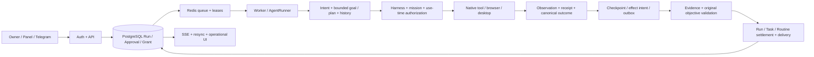

# Xagent — گزارش مهندسی OS2035 و بازسازی قابلیت اعتماد

تاریخ: ۲۰۲۶-۱۱-۰۵ · مخزن: [omerae7/Xagent](https://github.com/omerae7/Xagent) · شاخه: [`ccr-345833d2-sca9ob`](https://github.com/omerae7/Xagent/tree/ccr-345833d2-sca9ob) · [PR #2](https://github.com/omerae7/Xagent/pull/2)

## ۱. رأی مهندسی

این دور **پیاده‌سازی** است. کد موجود حفظ شد؛ پروژه، شاخه، framework یا سامانهٔ موازی ساخته نشد. VPS، دادهٔ تولید، حساب واقعی تلگرام، credential واقعی و API پولی مدل استفاده نشد. خط مبنای local و remote، قبل از تغییر، هر دو `c3257dcc375c93af38260902a83462304cebc588` و working tree پاک بود. CIهای [204](https://github.com/omerae7/Xagent/actions/runs/42038486813) و [205](https://github.com/omerae7/Xagent/actions/runs/42038497788) آن مبنا موفق بودند.

| معیار | ارزیابی مستقل |
|---|---|
| کیفیت UI/UX | زبان بصری یکپارچه، Chat و Command Center بازطراحی شدند؛ light/dark، RTL، جهت فیزیکی پیام‌ها، viewport کوتاه و دسترس‌پذیری آزموده شد. همهٔ فرم‌های محصول با دادهٔ واقعی تولید usability-test نشده‌اند. |
| خودمختاری عملکردی | مسیرهای قابل تکرارِ ابزار، فرم، approval و روتین واقعاً اجرا شدند؛ کیفیت تصمیم مدل واقعی برای درخواست‌های آزاد فارسی اثبات نشده است. |
| قابلیت اعتماد اجرا | خطاهای مشخص برنامه/شاهد/زمینه و ابهام ارسال اصلاح شدند. تضمین عمومی exactly-once برای سرویس بیرونی وجود ندارد. |
| زمان‌بندی | چرخهٔ ده‌دقیقه‌ای، وقوع هم‌زمان، restart شبیه‌سازی‌شده و تسویه در PostgreSQL/Redis تأیید شد؛ soak واقعی ۲۴/۷ نشده است. |
| مرورگر | Chromium واقعی و Chrome/Chromium گرافیکی کانتینری، persistence و fault injection تأیید شدند؛ سایت‌های ضدربات و حساب‌های واقعی آزموده نشدند. |
| تلگرام | native tool/outbox/receipt با bridge ساختگی تأیید شد؛ اتصال MTProto واقعی و تحویل اینترنتی تأیید نشده‌اند. |
| مجوز | once/mission/standing محدود، revocation، policy revision، identity و سقف استفاده اجرا شدند؛ permission به‌معنای اثبات effect نیست. |
| امنیت | کنترل‌های موجود حفظ شدند؛ ابهام اثر و طبقه‌بندی login تقویت شد. شبکهٔ مرورگر، دسکتاپ و filesystem مشترک هنوز مرزهای کامل چندمستأجری نیستند. |
| کارایی | اندازهٔ JS و تعداد nodeهای timeline اندازه‌گیری شد؛ بهبود FPS، زمان پاسخ مدل یا هزینهٔ واقعی ادعا نمی‌شود. |
| آمادگی انتشار | مناسب آزمون ایزوله و staging کنترل‌شده، مشروط به CI همین کد و حساب/شبکهٔ محدود. **آمادهٔ تولیدِ بدون نظارت نیست.** |

این گزارش ادعای بازخوانی خط‌به‌خط تمام dependencyها یا ممیزی نفوذ کامل نیست. inventory و parse کل Python با بازبینی عمیق همهٔ خطوط تفاوت دارد. شواهد، محدودهٔ هر ادعا را مشخص می‌کنند.

## ۲. معماری واقعی و علت ناکامی‌های عملی



مسیر زمان‌دار: `Scheduler → Routine → occurrence Run → watch precheck(EventInbox) → Mission authorization → native telegram_send → outbox/receipt → after_routine_run → parent Routine`. هنگام انتظار، مدل حلقهٔ polling اجرا نمی‌کند. PostgreSQL مرجع وضعیت پایدار است؛ Redis مرجع queue/lease/Takeover؛ browser مرجع DOM/profile؛ UI مصرف‌کنندهٔ وضعیت است. صف، DB و سرویس بیرونی تراکنش مشترک ندارند.

ریشهٔ ناپایداری در این دور صرفاً «ضعف مدل» نبود: hint مدل به الزام اجرایی تبدیل می‌شد؛ goal stage قبل از دیدن history سؤال می‌پرسید؛ typing از locator متن عمومی استفاده می‌کرد؛ دو نام متفاوتِ uncertainty دو رفتار متفاوت ایجاد می‌کردند؛ liveness به‌جای readiness مصرف می‌شد. اصلاح‌ها در مرزهای مسئولیت انجام شد؛ prompt بزرگ‌تر جایگزین آن‌ها نشد.

### نقشهٔ مسئولیت‌ها و پوشش

| مسئولیت | کد مرجع | سطح شاهد این دور |
|---|---|---|
| runtime، planning، verification، recovery | `packages/agent_core/xagent_agent/{pipeline,planning,validation,stoploss}.py` | source + regression + engine واقعی با provider کنترل‌شده |
| provider/routing/usage | `providers/`، `model_select.py`، `router.py`، `usage_ledger.py` | source و suite موجود؛ بدون API پولی و bill واقعی |
| tools/permissions/MCP | `packages/tools/xagent_tools/{base,registry,mcp_client}.py`، `harness.py`، `grants.py` | source، permission concurrency، اثرهای محلی و mock protocol |
| browser/desktop | `builtin/computer.py`، `infra/desktop/`، `sandbox.py` | DOM واقعی، دو browser گرافیکی، hang/reconnect/restart/Takeover |
| Telegram/scheduler/lifecycle | `builtin/telegram.py`، `missions.py`، `watch.py`، worker `scheduler.py`/`telegram.py` | PostgreSQL/Redis واقعی؛ model/MTProto ساختگی؛ ساعت مجازی |
| memory | `packages/memory/xagent_memory/{context,working,store}.py` | source، context و migration suite؛ کیفیت retrieval زنده بررسی نشده |
| API/auth/session/DB | `services/api/xagent_api/routers/`، `deps.py`، core `models.py`/`approvals.py` | API واقعی، نقش viewer، schema migration، SSE revocation |
| frontend | `apps/web/src/` | build، پنل متصل به API واقعی، component/browser tests و صفحات با API ساختگی |
| infra/install/update | `compose.yaml`، Caddy، `install.sh`، `infra/updater/`، `infra/scripts/` | source/static، TLS و desktop محلی؛ updater کامل وابسته به runner CI |
| tests/docs/dependencies | `tests/`، `docs/audits/`، pyproject و npm lock | تمام suite، inventory/AST؛ scanner npm محدود، نه ممیزی کامل OS/Python supply chain |

`os2035-inventory.csv` فایل‌ها را با مسئولیت/تعداد خط/hash فهرست می‌کند. bundle/dependency directory، secrets و دادهٔ runtime جزو گزارش نسخه‌پذیر نیستند. پیشینهٔ F01–F22 در `forensic-remediation.md` و `forensic-closure-report.md` و اصلاحات C01–C10 در `codex-followup-engineering.md` خوانده شد؛ اثبات این دور متکی بر اجرای مجدد suite و مسیرهای مشخص زیر است، نه صرفاً برچسب VERIFIED قبلی.

## ۳. نقص‌های تأییدشده و اصلاحات

| ID / شدت | علت و محل | بازتولید و اصلاح | پذیرش / رگرسیون | ریسک باقی‌مانده |
|---|---|---|---|---|
| O01 / P1 | `validation.evidence_issues`، `pipeline._pipeline`: هر `tool_hint` برنامه شرط موفقیت بود | `memory, episodes` و `web, browser` یک routine ذخیره‌شده را رد کردند. `planning.normalize_plan` schema محدود/typed دارد؛ group به tool ID تبدیل نمی‌شود؛ hint اختیاری مرجع هدف نیست. | `test_os2035_planning.py`؛ tool result گم‌شده و هدف ارسالِ واقعی همچنان fail می‌شوند. | تشخیص هدف برای زبان آزاد هنوز heuristic/model است؛ normalization تضمین فهم عمومی نیست. |
| O02 / P1 | goal/criteria ساخت روتین با اقدام شرطی آینده مخلوط می‌شد | `normalize_goal(... scheduled_creation=True)` معیار creation را persistence و بازخوانی schedule/scope می‌داند. وقوع‌های آینده مستقل‌اند. | creation در workflow فارسی + ده وقوع مجزا؛ `test_os2035_telegram.py`. | «سایت را بررسی کن و جداگانه روتین هم بساز» به معیارهای چندهدفهٔ دقیق‌تری نیاز دارد؛ creation شاهد خواندن فوری نیست. |
| O03 / P1 | `computer.browser_type` از `_locator` عمومی متن استفاده می‌کرد؛ ابزار فقط value را الزامی می‌دانست | سه شکست روی browser واقعی: بدون selector، contenteditable و مقصد stale/ambiguous. انتخاب فقط از editable واقعی، ref/selector/accessible label؛ چند مقصد → بدون fill رد می‌شود. مقدار واقعی بازخوانی می‌شود. | `test_os2035_browser.py` + continuity/authz قبلی؛ draft بدون submit، صفر ارسال. | به‌جای حدس و کلیک کور، مقصد مبهم نیازمند مشاهدهٔ دوباره است؛ Telegram Web واقعی تست نشده. |
| O04 / P1 | goal/planner فقط درخواست جاری را می‌دیدند؛ history بعداً وارد executor می‌شد | `_planning_input` summary و window محدود همان conversation را پیش از clarification بارگذاری می‌کند و پیام همین Run را تکرار نمی‌کند. | history فرم در ورودی هدف‌سنجی حاضر است؛ `test_os2035_planning.py`. | مدل هنوز می‌تواند سؤال غیرضروری بپرسد؛ corpus زندهٔ فارسی/کیفیت تصمیم ارزیابی نشده. |
| O05 / P2 | `execution_required` وجود `employee_id` را دلیل الزام ابزار می‌گرفت | greeting سادهٔ کارمند بدون اثر بیرونی، شاهد ابزار می‌خواست. identity از objective جدا شد؛ ادعای اقدام و درخواست مرورگر همچنان به اجرا نیاز دارند. | کنترل مثبت/منفی در planning suite. | router broad hints هنوز ممکن است مسیر پرهزینه‌تر انتخاب کنند. |
| O06 / P1 | native Telegram `data.uncertain` می‌داد؛ guard فقط `outcome_uncertain` را می‌خواند | در build میانی همین دور، با bridge ساختگی و مجوز محدود، Timeout پس از effect به **۱۵ ارسال محلی** انجامید؛ این trace تولید یا اجرای baseline دست‌نخورده نیست، اما اختلاف نام uncertainty در کد baseline هم موجود بود. `checked_result` نام‌های قدیمی uncertainty را canonical می‌کند؛ checkpoint/replay نامعلوم نیز پیش از مدل بعدی متوقف می‌شود. | `test_os2035_effects.py`: یک effect، صفر call جدید پس از ambiguity، Run failed و outcome=UNKNOWN_EFFECT؛ receipt سالم همچنان موفق. | نتیجهٔ نامعلوم نیازمند reconciliation است؛ exactly-once عمومی ادعا نمی‌شود. سناریوی ۱۵ اثر با bridge ساختگی است، نه حساب مالک. |
| O07 / P2 | `live.stream` انتظار queue را ثابت ۱۵ ثانیه می‌گرفت، مستقل از deadline احراز | تست revocation در حالت ساکت timeout داد و ۱۵ شکست بعدی از نشست مشترک نامعتبر آمدند. timeout اکنون min(keepalive, remaining auth deadline) است؛ getter در cancellation هم جمع می‌شود. | تست SSE واقعی قبلی؛ cleanup تست در finally، بدون کاهش assertion امنیتی. | interval تولید همچنان ۶۰ ثانیه است؛ ابطال آنی شبکه‌ای ادعا نمی‌شود. |
| O08 / P2 | Docker سلامت دیمن را سلامت دسکتاپ می‌دانست | `/health` liveness را حفظ می‌کند؛ `/ready` CDP و X display قابل استفاده را می‌سنجد و 503 می‌دهد. فقط healthcheck سرویس desktop تغییر کرد؛ Runner گرافیک لازم ندارد. | agentd واقعی + Chrome و Chromium: STOP process → readiness=503، daemon live؛ CONT → ادامه. | readiness اثبات کارکرد یک سایت یا اعتماد certificate نیست؛ خطای profile نیازمند تشخیص است و lock زنده حذف نمی‌شود. |
| O09 / P2 | RTL در `MessageBubble` جهت flex مالکیت را معکوس می‌کرد | screenshot پایه کاربر چپ/ایجنت راست؛ محور ردیف اکنون فیزیکی LTR و متن هر bubble RTL است. | ۹ عرض × دو theme؛ user راست، agent چپ، code بدون overflow. | سنجش mobile keyboard شبیه‌سازی viewport است؛ IME روی iOS/Android واقعی تست نشده. |
| O10 / P2 | cursor تاریخچه فقط timestamp بود، و UI older history نداشت | ۶۵ پیام با timestamp یکسان → تنها ۶۰ پیام قابل مشاهده. keyset `(created_at,id)`، cursor همان conversation، `has_more` و کنترل پیام‌های پیشین اضافه شد. | دو تست API منفی قبل/مثبت بعد؛ اطلاعات Run صفحهٔ پیشین حفظ می‌شود. | شمار بسیار زیاد پیامِ عمداً بارگذاری‌شده هنوز virtualization ندارد. |
| O13 / P1 | `evidence_issues`، بازیابی یک read را برای پاک‌کردن شکست typing/click کافی می‌دانست | بازتولید منفی: browser_type ناموفق + browser_read موفق → بدون issue. اکنون read شکست UI action را پنهان نمی‌کند؛ retry همان operation می‌تواند با شاهد واقعی آن را حل کند. برای click با NOT_STARTED، click واقعاً اجراشده و مشاهدهٔ تازهٔ بعد از آن لازم است؛ خطای مبهم قابل چشم‌پوشی نیست. هدف صریح تایپ فارسی/انگلیسی، field_verified می‌خواهد. | planning/validation regressions، DOM واقعی و مسیر panel approval. | استخراج intent تایپ هنوز bounded heuristic است؛ formal objective برای هر زبان/عملیات وجود ندارد. |
| O12 / P1 | `telegram._reconcile` و cached outbox، متن مشابه/نام «من» را به رسید مرتبط نمی‌کردند | پیام قدیمیِ هم‌متن، حتی بدون receipt، success می‌داد. اکنون فقط message ID ثبت‌شده + پرچم outgoing واقعی SDK + متن مقصد تطبیق می‌یابند؛ cached sent بدون رسید، unknown می‌ماند. | `test_os2035_reconciliation.py`: کنترل منفی/مثبت و outbox واقعی، بدون ارسال مجدد. | بدون ID ثبت‌شده، تطبیق خودکار عمداً انجام نمی‌شود؛ dedupe یک دستور تازه در Run دیگر تضمین عمومی ندارد. |
| O11 / P2 | code block قابل اسکرول keyboard focus نداشت | axe در هر دو theme `scrollable-region-focusable` داد. `pre` با tabindex و توضیح فارسی قابل پیمایش شد؛ XSS escaping حفظ شد. | axe WCAG A/AA و تست XSS واقعی؛ assertion قدیمی HTML به semantic markup سازگار شد، payload حفاظتی حذف نشد. | axe جای screen-reader و ارزیابی کامل همهٔ صفحات را نمی‌گیرد. |

اصلاح‌های O01/O02/O03/O04/O06 به‌ترتیب در `planning.py`، `validation.py`، `computer.browser_type`، `pipeline._planning_input` و `checked_result/_process_calls` هستند. O07 در `services/api/xagent_api/routers/live.py:stream`، O08 در `infra/desktop/agentd.py:health/ready`، O10 در `routers/chat.py:list_messages` است. نام توابع مرجع پایدار است؛ lineهای دقیق در inventory/diff Commit قابل مشاهده‌اند.

همهٔ اصلاح‌ها افزایشی/سازگار با constructor فعلی ToolResult و APIهای قبلی‌اند، به‌جز رد صریح cursor نامربوط و حداقل limit=1. دادهٔ موجود بازنویسی نشد. تنزل assertion ظاهری `<pre><code>` برای اجازه‌دادن به attribute دسترس‌پذیری، با بررسی escaping و tabindex جایگزین شد؛ بررسی اجرای XSS/handlerها باقی است. مدل ساختگی pagination قبلاً قیمت را از state مستقیم fixture می‌دانست؛ اکنون فقط پس از browser_read حاوی قیمت نهایی پاسخ می‌دهد. FakePage نیز وجود واقعی ref را بازنمایی می‌کند؛ مدل دیگر oracle مستقل از خروجی ابزار نیست.

## ۴. مجوزهای محدود: پیاده‌سازی و حدود امنیتی

فایل‌های جدید `grants.py` و migration افزایشی `0008_scoped_permission_grants.py`، دو جدول `permission_grants` و `permission_uses` می‌سازند. هیچ rule قبلی به auto تبدیل و هیچ grant خودکار برای نصب موجود ایجاد نمی‌شود. owner از تصمیم API و `requested_by` ثبت‌شده می‌آید؛ مدل حق ساخت grant ندارد.

- **once:** همان Run/call ID/arguments/DOM binding قبلی؛ عوض‌کردن call یا payload، تأیید یک‌باره را معتبر نمی‌کند.
- **mission:** همان محدوده، به ریشهٔ Run فعال یا Mission مشخص محدود است؛ پایان/لغو/انقضای مأموریت آن را قابل استفادهٔ بعدی نمی‌کند.
- **standing:** اقدام و مقصد مشخص؛ UI صریحاً می‌گوید متن‌های جدید هم در همان محدوده مجاز می‌شوند. پیش‌فرض ۳۰ روز/۱۰۰ attempt؛ API سقف ۹۰ روز/۱۰۰۰ دارد. «پایدار» به‌معنای نامحدود یا همیشگی نیست.
- owner، employee، tool، category، scope HMAC، policy revision، expiry، max uses و revocation در use-time بررسی می‌شوند. row lock و unique claim از عبور دو Run از سقف مشترک جلوگیری می‌کنند. تکرار check همان call شمارش جدید نیست.
- scope native Telegram به **گیرندهٔ مشخص و پیام متنی** محدود است؛ فایل شامل آن نیست. scope مرورگر، URL و عنصر/رفتار مشاهده‌شده را هم bind می‌کند. مقدار payload/credential در grant ذخیره نمی‌شود.
- login، payment، unknown/destructive web effect، code، installation و تغییر سیاست از reuse خارج‌اند. فرم login با نام/action واقعی دیگر از grant پیام استفاده نمی‌کند.
- سیاست ممنوع، mission gate، employee tool groups، STOP_ALL، lineage و owner Takeover همچنان مستقل اعمال می‌شوند. Permission، receipt یا تضمین ایمنی محتوای پیام نیست. نام کاربری Telegram هنوز alias قابل تغییر است؛ binding به ID پایدار حساب برای production باید تکمیل شود. DOM label نیز proof معنای تجاری JavaScript یک سایت نیست؛ grant مرورگر را در staging فقط روی صفحهٔ آزمایشی/شناخته‌شده به کار ببرید. این محدودیت با verifier اثر و مرز شبکه باید پیش از unattended رفع شود.

تنظیمات Harness فهرست و revoke را از API owner-only ارائه می‌کند. تست‌ها: actor/employee/mission/policy/expiry/revocation/limit، callback تکراری، rollback تصمیم نامعتبر، viewer=403، دو Run هم‌زمان و فرم واقعی پس از approval. شمار uses، authorization attempt است؛ شمار verified success نیست.

خطر تصحیح: migration جدید، منطق approval و UI قرارداد جدید دارند؛ ریسک رگرسیون متوسط. upgrade فقط جدول اضافه می‌کند. downgrade صریح جدول‌های جدید/تاریخچهٔ آن‌ها را حذف می‌کند؛ **در rollback معمول کد، schema افزایشی را نگه دارید** یا ابتدا history را export کنید و هشدار updater را بخوانید. هیچ downgrade/restore تولید اینجا اجرا نشده است.

## ۵. طراحی محصول

هویت بصری اصلی با Orbit برداری اختصاصی، اقیانوسی/یخی، سطوح مات، لبهٔ روشن و فضای تنفس ساخته شد. تصاویر ارسالی جهت بصری بودند؛ عکس‌ها، لوگوها و artwork مرجع وارد محصول نشدند. Vazirmatn، React، Tailwind، Framer Motion و Lucide موجود حفظ شدند.

- `styles/tokens.css`: رنگ/semantic state مستقل، سطح/blur/shadow، اندازه و line-height، spacing/radius و motion/easing؛ light/dark.
- `Shell`: ریل/نوار/داک هماهنگ، skip link، badge مجوز در داک موبایل؛ blur فقط در سطوح شناور و کمتر روی موبایل؛ filter blur متحرک صفحه و breathing دائمی کارت حذف شد.
- `Chat`: پیام کاربر راست و ایجنت چپ؛ Markdown و mixed text ایمن؛ bubble محدود، history paging، composer وابسته به visual viewport، scroll کمتر مزاحم خواننده، reduced motion.
- `ExecutionStatus` و `StepList`: برنامه ≠ اجرای ابزار ≠ شاهد تأییدشده؛ ambiguity و approval مشخص‌اند. پیش‌فرض شش مرحلهٔ تازه، تمام لاگ‌ها قابل بازکردن؛ ۱۰۰۰ مرحله در DOM پیش‌فرض رندر نمی‌شود.
- `Dashboard`: مرکز فرمان Orbit، وضعیت ورودی/کارمند و اعداد واقعی API؛ نمونهٔ عدد تولیدی ساخته نشده است.
- `Desktop`: وضعیت CDP/version از سلامت دیمن و اتصال تصویر جدا نمایش داده می‌شود. `Settings/Harness`: دامنهٔ مجوز و revoke.
- Tasks، Routines، CRM/Employees، Desk/History، Tools، Memory، Dream، Usage، Models/Telegram/Settings، Login از tokens، controls و Shell مشترک استفاده می‌کنند؛ فرم‌ها/APIهای موجود حفظ شدند. ادعای بازطراحی تک‌تک گردش‌های تخصصی یا usability تأییدشدهٔ همهٔ آن‌ها نمی‌شود.

تصاویر زیر همه با دادهٔ ساختگی‌اند؛ شاهد وضعیت VPS نیستند:

| پایه | روشن دسکتاپ | تاریک دسکتاپ | روشن موبایل | تاریک موبایل |
|---|---|---|---|---|
| [قبل](os2035/baseline-chat.png) | [بعد](os2035/chat-light-desktop.png) | [بعد](os2035/chat-dark-desktop.png) | [بعد](os2035/chat-light-mobile.png) | [بعد](os2035/chat-dark-mobile.png) |

در fixture پنل، ۳۲۰، ۳۶۰، ۳۷۵، ۳۹۰، ۴۳۰، ۷۶۸، ۱۰۲۴، ۱۴۴۰ و ۱۹۲۰ پیکسل، هر دو theme و ارتفاع کوتاه بررسی می‌شوند. navigation surfaces در ۳۶۰/۱۴۴۰ با API ساختگی از نظر exception و overflow بررسی شدند. screenshot، compilation و axe، proof اتصال noVNC اینترنتی یا کیفیت تمام فرم‌ها نیستند.

## ۶. مرورگر و Chrome

اصلاح قبلیِ `release_session` که فقط claim/lease را آزاد می‌کند حفظ شد؛ این دور آن را دوباره با پایان Run و پاسخ واقعی پنل آزمود. عمر process، identity/context، tab، Run، lease و profile همچنان جدا هستند. close صریح، سقف tab و منع cleanup تب user/pinned/فعال حفظ شدند.

انتخاب پیش‌فرض تغییر نکرد: روی amd64 تازه، Chrome رسمی؛ نصب دارای Chromium profile قدیمی همان Chromium را نگه می‌دارد؛ architecture فاقد Chrome رسمی fallback دارد. profileها کپی/حذف نشدند. Chrome Sync یا ورود خودکار Google ادعا نمی‌شود. CDP/VNC فقط شبکهٔ داخلی Compose دارند؛ port عمومی جدید اضافه نشد.

image محلی نهایی با Dockerfile واقعی و wrapper صرفاً مربوط به trust/proxy این محیط ساخته شد؛ CA موقت BuildKit secret در image نگهداری نشد. آزمون‌های graphical از image استفاده کردند، نه mock صفحه. نسخه‌های مشاهده‌شده و RSS/startup در `os2035-evidence.json` آمده‌اند. دادهٔ cookie ساختگی به SQLite خود browser رسید و سپس restart شد. RSS جمع processها حافظهٔ فیزیکی یکتا نیست؛ نمونهٔ منفرد زیر بار محیط، benchmark مقایسه‌ای Chrome/Chromium نیست.

Lock زندهٔ profile حذف نمی‌شود. علت warningهای VPS بدون دسترسی به log/profile تولید قابل اثبات نبود؛ readiness اکنون عدم قابلیت استفاده را آشکار می‌کند، ولی خودسرانه credential/profile را بازسازی نمی‌کند. Context خصوصی employee دارای persistence محدود cookie/LocalStorage است؛ تضمین حفظ همهٔ tab/SessionStorage پس از crash/reconnect ندارد.

## ۷. بررسی ده پروژهٔ مرجع

revision و SHA256 تمام فایل‌های source/test/license انتخابی مجدداً با cache مخزن تطبیق داده شد؛ snapshotهای دقیق زیر بررسی شدند، نه README یا ادعای آخرین نسخه. تست‌های upstream اجرا نشدند. جدول، الهام مفهومی را از implementation واقعی Xagent جدا می‌کند. هیچ framework یا کد آن پروژه‌ها وارد Xagent نشد.

| مرجع / revision | شاهد production/test | معادل و شکاف Xagent | تصمیم این دور |
|---|---|---|---|
| Hermes `d0001c5ba236a31ebcc679acc38516f05a9847fa` | `agent/context_compressor_prune.py`؛ `tests/agent/test_413_compression.py` | `memory/context.py`، `working.py`، `fit_request`؛ compaction پایدار/cache-aware کامل نیست | حفظ pruning قطعی و history محدود؛ compressor چند‌هزارخطی/فراخوانی اضافه برای هر task رد شد. |
| OpenClaw `de04fbe0caa9332999bdcc28d5d4e049672afb16` | `src/acp/approval-classifier.ts` و test؛ `session-actor-queue.ts` | Harness/use-time auth + browser claims؛ actor runtime برابر آن نیست | scope واقعی و fail-closed identity به grant/locator اعمال شد؛ autoapprove از نام ابزار/متن صفحه اقتباس نشد. |
| Agent Zero `ba9b67df0f54ac78106ae85c552ef5d2458f7c9a` | `agent.py`، `helpers/tool.py`، browser output test | ToolResult و loop/checkpoint از قبل موجود | قرارداد outcome تقویت شد؛ message/break_loop به‌تنهایی proof اثر محسوب نشد. |
| Paperclip `3a090b815b9f84873720fa2d0b9bbc114e5054e1` | `budget-admission-controls.ts`، `budget-reservations.ts` و test | usage ledger، employee/delegation موجود؛ سازمان/حسابداری کامل نیست | الگوی recheck و serialization برای grant use تقویت شد؛ دفتر مالی دوم ساخته نشد. |
| n8n `7a1577667ead44c456b8353f05339045f0a4c006` | `execution-recovery.service.ts` و integration test؛ `scheduled-task-manager.ts` | scheduler slots، reconciliation، checkpoint/outbox موجود | receipt/settlement و سناریوی restart/دو scheduler آزموده شد؛ کل workflow framework رد شد. |
| Dify `5253ee2f08203429c479792e40bff19c3137287b` | `model_runtime.py`، `workflow_tool_node.py`؛ parallel human-input resume test | providers، Run/Approval و typed boundary | planning schema و approval resume واقعی تقویت شد؛ plugin runtime موازی رد شد. |
| UI-TARS `3ac2cb8d946d78d5ff92ad17b318eaafa18c178c` | `agent/operator.ts` و test؛ `GUIAgent.ts` | screenshot/vision، GUI input/Takeover موجود؛ grounding تعمیم‌یافته اثبات نشده | مشاهده و اثر جدا ماندند؛ screenshot صرف به verified تبدیل نشد. dependency بزرگ GUI افزوده نشد. |
| Browser Use `b49a68e4060acb226da8f784194fef301c53a6d7` | `browser/profile.py`، `browser/session.py` و session test | lifetime/identity/lease جدا؛ private tab recovery محدود | editable target + persistent profile tests؛ copying profile، حذف lock و disable-web-security flags آن انتخاب نشد. |
| CrewAI `6bd60b223101a11f7ac675706ff1ebb03314c95d` | `task.py`، `delegate_work_tool.py`، `utilities/guardrail.py` و hallucination test | roles/delegation/validation موجود؛ فرزند همچنان عمدتاً synchronous است | guardrail شواهد مستقل از prose/plan حفظ شد؛ callable/prompt معیار کافی برای اثر بیرونی نیست. |
| DeerFlow `4a53a36e32a7245e4ac2d5e80115ce7e31f8bd6c` | subagent-limit/summarization/tool-error middleware و test | StopLoss و checkpoint موجود | bounded plan/timeline/unknown-effect stop؛ لایهٔ orchestration دوم افزوده نشد. |

trace کامل source/test/hash در `codex-followup-references.json` موجود و در این دور دوباره تطبیق داده شده است. MIT برای Hermes/OpenClaw/Agent Zero/Paperclip/Browser Use/CrewAI/DeerFlow، Apache-2.0 برای UI-TARS، و شروط اختصاصی n8n و Dify در LICENSEهای snapshot دیده شدند. similarity اثبات provenance نیست. چون source کپی نشد و framework dependency افزوده نشد، ادعای مشتق‌شدن از این پروژه‌ها یا انتقال مجوز آن‌ها به Xagent نمی‌شود.

## ۸. شواهد آزمون و اندازه‌گیری

نتایج نهایی در `os2035-evidence.json` و `os2035-verification.txt` ثبت می‌شوند؛ مقدار نهایی فقط پس از پایان command درج شده است. بازتولیدهای این گزارش محلی/قراردادی‌اند؛ به‌جز شرح مالک، trace یا DB از VPS دریافت نشده و ریشهٔ دقیق هر رخداد تولید به همان trace نیاز دارد. رکورد شکست‌های پیش‌ازاصلاح نیز نگه داشته شده است.

| بررسی | ماهیت / حدود |
|---|---|
| baseline | ۴۶۱ passed، ۰ failed، ۰ skipped، ۲۹۵٫۱۷s؛ شامل ۴۲۴ قبلی + ۳۷ رگرسیون دور پیش |
| release suite | **۵۴۸ passed، صفر failed و صفر skipped، 349.25s**؛ ۴۶۱ پایه بدون حذف + ۸۷ مورد جدید؛ PostgreSQL/Redis و Chromium محلی، model کنترل‌شده |
| پنل واقعی متصل | React → owner auth → API → Run → AgentRunner → DOM → approval API → همان effect → receipt/response → tab باز؛ مصرف Worker queue به‌صورت مستقیم با AgentRunner هدایت شد، نه soak Worker |
| Telegram happy path | ۱۰ occurrence، ۲ reply/receipt، ۸ interval خالی با ۰ model call؛ duplicate event و settlement، دو scheduler و restart شبیه‌سازی‌شده |
| receipt reconciliation | ID ثبت‌شده، outgoing واقعی و outbox واقعی؛ متن مشابه، نام نمایشی و cached status به‌تنهایی تأیید نیستند. |
| native ambiguity | منفی: ۱۵ effect ساختگی؛ مثبت: یک effect و بدون model call بعد از uncertainty |
| permission | دو Run/سقف مشترک، policy/employee/owner/mission، revoke/expiry، callback تکراری، owner-only و SQL واقعی |
| browser | DOM واقعی و Chrome/Chromium گرافیکی؛ synthetic form، draft، cookie restart، Takeover، hung-browser readiness |
| Caddy | IP، domain و override؛ TLS بدون SNI، routing و restart موفق؛ system CA certificate را رد کرد، explicit internal CA موفق بود |
| UI/a11y | ۹ عرض × light/dark، reduced motion، viewport کوتاه، navigation، component timeline، axe WCAG A/AA و XSS |
| static/build | ruff، Python AST، shell syntax، TypeScript/Vite؛ dependency runtime جدید ندارد |
| updater/migrations | regression suite و CI؛ اجرای کامل updater محلی به root/chown/systemd ایزوله نیاز دارد و قبلاً در این محیط blocked بوده است. موفقیت آن از نتیجهٔ job containers روی SHA نهایی جدا گزارش می‌شود. |

حد شاهد baseline: فرمان ۴۶۱ موردی از working tree پاک آغاز شد و Python آن تا پایان ثابت ماند؛ کار طراحی frontend با بخشی از اجرای طولانی هم‌پوشانی داشت. بنابراین آن اجرا را به‌تنهایی baseline بصری کاملاً immutable نمی‌نامیم. assetهای اصلی که پیش از ویرایش build شده بودند جداگانه و بدون تغییر با مرورگر بررسی شدند: outage صفحهٔ خطا نشان داد، recovery به صفحه برگشت، قطع SSE باعث logout نشد و 401 به login رفت. screenshot «قبل» نیز از همان build اصلی است؛ این بازسنجی محدود، جای ممیزی تمام UI اولیه را نمی‌گیرد.

دو اجرای میانی «موفق» گزارش نشدند: اول ۵۰۰ passed/۱۶ failed که ابتدا SSE timeout و سپس token contamination بود؛ پس از اصلاح، اجرای بعدی ۵۱۹ passed/۲ failed شامل assertion نادرست کنترل greeting و viewport پیش از ثبات layout بود. اجرای بعد ۵۲۹ passed/۱ failed به literal HTML test وابسته بود؛ payloadهای XSS حذف نشدند. پس از آن checkpointهای ۵۳۱، ۵۳۳ و ۵۴۲ موفق شدند. اجرای ۵۴۵ موردی یک شکست در بازیابی mock مرورگر داشت؛ انتظار مشاهدهٔ واقعی و recovery امن اصلاح شد و هدف ۴۳ موردی موفق شد. این‌ها نتیجهٔ نهایی نیستند؛ نتیجهٔ checkpoint پیشین ۵۴۷/۰/۰ بود؛ پس از تقویت fixture، نتیجهٔ نهایی ۵۴۸/۰/۰ است و شواهد میانی حفظ شده‌اند.

sum همهٔ chunkهای JS غیر‌فشرده: baseline **۹۶۴٬۹۱۵ bytes**، پس از تغییر **۹۶۸٬۰۰۶ bytes**، اختلاف **۳٬۰۹۱ bytes / ۰٫۳۲٪**. شامل chunk تنبل noVNC است؛ initial-load و FPS نیست. dependency جدید فقط `axe-core@4.14.0` در devDependencies و lockfile است. هزار مرحله → شش node در حالت خلاصه؛ با بازکردن، هزار مرحله قابل مشاهده است. عدد دلار یا token saving واقعی وجود ندارد؛ نتیجهٔ idle-zero با مدل ساختگی اندازه‌گیری شده است. بارگذاری history با بودجهٔ حدود ۱۸۰۰ توکنِ تخمینی در هر ورودی goal/planning می‌تواند توکن درخواست پیچیده را افزایش دهد؛ call مدلی تازه اضافه نشده و tradeoff برای جلوگیری از clarification بدون زمینه است. fitting تمام callهای فرعی و سنجش cost per verified objective هنوز لازم است.

npm audit runtime در همین محیط **۳ high، صفر critical** در زنجیرهٔ React Router گزارش کرد. این scanner finding است؛ exploit در BrowserRouter فعلی اثبات نشد و بدون بررسی سازگاری، major upgrade انجام نشد. Python constraints عمدتاً باز و Docker baseها tag هستند؛ reproducibility کامل حل نشده است. Node محلی ۲۴ با CI Node۲۲ متفاوت است؛ CI باید مستقلاً نتیجه دهد.

## ۹. بازسنجی اصلاح‌های گذشته و شکاف‌ها

F01–F22 از گزارش پیشین با آزمون‌های باقی‌مانده دوباره سنجیده می‌شوند: secret redaction/XSS، authz use-time، employee browser context، cancellation، objective/evaluation، migration memory، cost ledger/SDK retries، updater safety، SSE recovery، TLS، receipt، rollback ابزار و context capacity. پاس آن‌ها فقط همان سناریوها را اثبات می‌کند؛ تضمین عمومی امنیت یا integration زنده نیست. این دور آسیب‌پذیری جدید uncertainty را دقیقاً با وجود تست‌های سبز پیشین پیدا کرد.

| ریسک معماری قبلی | وضعیت امروز |
|---|---|
| replay پس از crash | effect_intents/outbox موجود؛ legacy uncertainty و guard resume اصلاح شد؛ اثر عمومی بدون reconciliation همچنان نامعلوم می‌ماند. |
| persistent browser ownership | owner target/lease و تب پایدار آزموده شد؛ private context و SessionStorage کامل restart-durable نیست. |
| desktop authority مشترک | باقی؛ browser context، کل دسکتاپ/clipboard/screenshots را از هم جدا نمی‌کند. Chrome همچنان با `--no-sandbox` موجود در container اجرا می‌شود؛ این جای sandbox process کامل نیست و قبل از تولید نیازمند hardening مرز OS/container است. |
| browser SSRF/شبکه خصوصی | باقی؛ URL guard HTTP معادل network isolation مرورگر و همهٔ redirect/subresourceها نیست. |
| VNC revocation | بازسنجی نشست موجود و suite آن حفظ شد؛ noVNC زنده روی اینترنت مالک تست نشد. |
| control inbox durability/backpressure | regressionهای موجود حفظ؛ crash/partition طولانی واقعی اجرا نشده. |
| event routine concurrency | slots و سناریوی concurrent scheduler پوشش دارند؛ چند Worker مستقل زیر partition/soak هنوز لازم است. |
| shared filesystem employees | باقی؛ مسیر مشترک معادل workspace security per employee نیست. |
| child delegation/timeout | parent cancellation/حدود موجود؛ واگذاری عمدتاً synchronous و طولانی‌مدت محدود است. |
| capability readiness | CDP protocol probe قبلی و desktop readiness جدید؛ نصب/پیکربندی provider اثبات سلامت real call نیست. |
| MCP write evidence | fail-closed باقی؛ read-only annotation، proof مستقل یک mutation نیست؛ verifier اختصاصی لازم است. |
| historical plaintext secrets | API redaction جای migration و rotation تاریخی را نمی‌گیرد؛ دادهٔ تولید بررسی/تغییر نشد. |
| learning/context | failure evidence و bounds حفظ شدند؛ relevance/privacy همهٔ skillها و کیفیت حافظهٔ طولانی نیازمند بررسی عمیق‌تر است. |
| retry/cost accounting | attempt ledger و unknown exposure موجود؛ bill واقعی/قیمت catalog/live-provider retries تأیید نشده‌اند. |
| update/public health | TLS/config regression موفق؛ public reachability، trust مرورگر و rollout/rollback VPS مستقل‌اند. |

## ۱۰. اولویت اصلاح‌های باقی‌مانده

| طبقه / اولویت | اقدام، دلیل و پذیرش | پیچیدگی / خطر |
|---|---|---|
| مانع staging | CI همین source، migration تازه و rollback بر دادهٔ ساختگی باید موفق باشند؛ staging باید حساب/شبکهٔ محدود و snapshot مستقل داشته باشد. | Small / Medium |
| مانع production / ۱ | مرز شبکهٔ مرورگر و workspace/desktop هر employee؛ DNS/redirect/subresource، cross-account و clipboard abuse باید رد شوند. تغییر مدل امنیتی/پیکربندی لازم است؛ بدون policy روشن دسترسی موجود خودسرانه قطع نشد. | Architectural / High |
| مانع production / ۲ | reconciliation و verifier اختصاصی اثرهای مهم/ابزارهای MCP؛ اثر نامعلوم نباید auto-retry شود. receipt و negative control واقعی لازم است. | Large / High؛ sandbox credentials |
| مانع production / ۳ | برنامهٔ export/migration/rotation اسرار تاریخی با پشتیبان؛ نیازمند تصمیم مالک و credential واقعی خارج از این محیط. | Large / High؛ maintenance |
| مانع production / ۴ | soak چند Worker/Redis outage/DB finalization failure/kill در مرز effect/checkpoint؛ هیچ settlement گم و retry غیرمجاز نباشد. | Large / Medium؛ disposable infra |
| مانع production / ۵ | dependency triage و reproducible build؛ advisoryهای runtime تعیین تکلیف، image/package revision pin و migration coordination. | Medium / Medium |
| پیگیری مهم | corpus فارسی، cost per verified objective، وضعیت واقعی providerها؛ بدون paid API مجاز قابل تأیید نبود. | Medium / Low؛ بودجهٔ آزمایشی مجاز |
| پیگیری مهم | persistent identity process برای employee، long-run delegation و session recovery کامل؛ credentialها نباید بین identityها کپی شوند. | Architectural / High |
| پیگیری مهم | phone/IME/screen-reader و تمام فرم‌ها با دادهٔ staging، Desktop/noVNC اینترنتی، Telegram account آزمایشی مستقل. | Medium / Medium؛ حساب اختصاصی |
| اختیاری | virtualization کامل history، pin/cleanup UI تب، polish تخصصی هر صفحه و performance trace روی دستگاه واقعی. | Medium / Low |

اجزای قابل حفظ: PostgreSQL state ownership، registry/tool interfaces، Harness/use-time checks، lease fencing، outbox، receipt verification، usage reservations، Caddy و updater موجود. نیاز به بازسازی کل پروژه اثبات نشد. مرز امنیتی multi-employee و delegation واقعاً durable به طراحی تکمیلی نیاز دارند؛ یک library تازه به‌تنهایی آن‌ها را حل نمی‌کند.

## ۱۱. تحویل GitHub و محدودیت اتصال

Commit production code: [`06220f56c05491e5841c85acd1dd077d55ab95fb`](https://github.com/omerae7/Xagent/commit/06220f56c05491e5841c85acd1dd077d55ab95fb). Commit اعتبارسنجی نهایی: [`0dac265d8db1dc24646b709db473f8f3c11d90ed`](https://github.com/omerae7/Xagent/commit/0dac265d8db1dc24646b709db473f8f3c11d90ed)؛ فقط fixture/test نسبت به checkpoint تغییر کرد و production source همان است. تمام ۵۴۸ آزمون با guard واقعی روی این Commit اجرا شدند؛ Commit بعدی فقط گزارش را به‌روز می‌کند. فهرست دقیق فایل‌ها و نتیجهٔ remote در verification companion ثبت می‌شوند. شاخهٔ مقصد همان شاخهٔ موجود است؛ merge/main/deploy انجام نشد. PR #2 از public HTML دارای marker **Draft** بود.

Git fetch/push و API دو مسیر متفاوت‌اند. `gh api repos/omerae7/Xagent/pulls/2` در این محیط `Get https://api.github.com/...: Forbidden` برگرداند؛ نشست وب هم logged-in نیست. تا رفع آن، ویرایش description PR قابل ادعا نیست. تنظیم لازم: افزودن HTTPS egress برای `api.github.com` در Codex Cloud network policy، سپس بررسی GitHub connection/App منتخب برای همین repo با **Pull requests: Read and write**. از این 403 نمی‌توان فقدان permission App را قطعی نتیجه گرفت. PAT در گفتگو درخواست نشد. نیازی به ساخت repo/PR جدید نیست.

## ۱۲. راهنمای دستی و امن VPS آزمایشی — اجرا نشده

این دستورات فقط برای مالک‌اند. SHA کد تأییدشده را از verification companion یا پاسخ نهایی جای‌گذاری کنید؛ ref شناور به‌جای SHA استفاده نکنید. مسیر سفارشی را از `/etc/xagent.conf` بررسی کنید. برای profile و env یک maintenance کوتاهِ اعلام‌شده لازم است؛ این گزارش خودش maintenance اجرا نمی‌کند.

```bash
sudo xagent version
sudo xagent doctor
df -h /opt/xagent
docker system df
git -C /opt/xagent/app status --short
sudo xagent backup
```

در صورت تغییرات محلی، ابتدا diff و نسخهٔ آن‌ها را خارج از app نگه دارید؛ reset/overwrite نکنید. فضای آزاد باید برای backup، source release و imageهای جدید **و قبلی** کافی باشد؛ حد ثابت ساختگی پیشنهاد نمی‌شود. در کمبود فضا توقف کنید؛ volume، profile، backup یا image rollback را prune نکنید.

```bash
STAMP="$(date -u +%Y%m%dT%H%M%SZ)"
sudo install -d -m 700 "/opt/xagent/backups/os2035-$STAMP"
sudo cp -a /opt/xagent/app/.env "/opt/xagent/backups/os2035-$STAMP/env"
sudo docker compose --project-directory /opt/xagent/app --env-file /opt/xagent/app/.env -f /opt/xagent/app/compose.yaml stop desktop
sudo tar -C /opt/xagent -cpf "/opt/xagent/backups/os2035-$STAMP/desktop-home.tar" desktop-home
sudo chmod 600 "/opt/xagent/backups/os2035-$STAMP/desktop-home.tar"
sudo docker compose --project-directory /opt/xagent/app --env-file /opt/xagent/app/.env -f /opt/xagent/app/compose.yaml start desktop
```

اگر profile desktop نصب نشده یا سرویس در آن نصب فعال نیست، بخش stop/tar/start desktop لازم نیست؛ path واقعی را بررسی کنید. برای گرفتن archive سازگار، browser متوقف می‌شود؛ گرفتن archive فعال را معادل backup معتبر login ندانید. هیچ profile به Chrome دیگر کپی نمی‌شود؛ `XAGENT_BROWSER=auto` انتخاب موجود را حفظ می‌کند.

```bash
TARGET_COMMIT='0dac265d8db1dc24646b709db473f8f3c11d90ed'
sudo xagent update --ref "$TARGET_COMMIT" --dry-run
sudo xagent update --ref "$TARGET_COMMIT"
sudo xagent version
sudo xagent status
sudo xagent doctor
```

installer را دوباره اجرا نکنید. `.env`، data، backups و desktop-home باید توسط updater موجود حفظ شوند؛ برنامهٔ migration فقط 0008 افزایشی است. updater rollback مربوط به schema ممکن است backup DB بخواهد؛ هشدار را بخوانید، dump و DB نسخهٔ ناموفق را حفظ کنید. `sudo xagent rollback` را فقط پس از ارزیابی تغییر داده‌های پس از update و snapshotها اجرا کنید؛ downgrade 0008 تاریخچهٔ مجوز جدید را نگه نمی‌دارد.

چک‌لیست مالک پس از به‌روزرسانی:

1. Dashboard از شبکهٔ بیرونی باز شود؛ TLS negotiation، اعتبار hostname و اعتماد certificate جدا بررسی شوند. Caddy internal CA، public trust نیست.
2. API و Worker readiness و log واقعی؛ desktop `/ready` و version واقعی Chrome/Chromium؛ CDP هیچ port عمومی نداشته باشد.
3. «example.com را باز کن و عنوانش را بگو»: DOM/title و تصویر مطابق؛ tab پس از پاسخ باز بماند؛ درخواست دوم همان tab مجاز را reuse کند.
4. فقط متن ساختگی در فرم محلی، بدون submit: field value درست و صفر effect بیرونی. برای submit ساختگی، scope صحیح → approve → یک effect → receipt → نتیجهٔ صادقانه.
5. Takeover ورودی agent را متوقف و return کنترل را برگرداند؛ دو employee نباید cookie/account خصوصی هم را ببینند.
6. روتین پنج‌دقیقه‌ای و چرخهٔ ده‌دقیقه‌ای Telegram فقط با حساب **آزمایشی مجاز**؛ empty interval بدون model call، receipt هر reply، parent active و occurrence terminal، پایان در موعد.
7. قطع/بازگشت کنترل‌شده Worker فقط در محیط آزمایشی: completed work محفوظ، unknown effect بدون resend، وضعیت قابل فهم.
8. حالت light/dark، موبایل با keyboard واقعی، timeline، expiry/revoke و SSE outage/reconnect بررسی شوند.
9. مصرف idle، attemptها و estimate/bill جدا دیده شوند؛ backup و image rollback تا پایان بررسی نگهداری شوند.

## ۱۳. نتیجه

این تحویل پیشرفت قابل آزمایش در اجرای واقعی، مجوز و رابط است؛ ادعای «همه چیز اصلاح شد»، استقلال عمومی مدل، اتصال زندهٔ تلگرام یا آمادگی unattended نمی‌شود. قبل از انتشار بعدی، CI همان SHA، migration/rollback ساختگی، isolation، uncertainty و checklist بالا گیت انتشار هستند. گزارش و کد جای مشاهدهٔ عملیاتی حساب/شبکهٔ واقعی را نمی‌گیرند.

## ۱۴. نمایهٔ دقیق کد آزموده‌شده

| یافته | محل در Commit کد |
|---|---|
| O01/O02 | [packages/agent_core/xagent_agent/planning.py:25](https://github.com/omerae7/Xagent/blob/06220f56c05491e5841c85acd1dd077d55ab95fb/packages/agent_core/xagent_agent/planning.py#L25) |
| O03 | [packages/tools/xagent_tools/builtin/computer.py:790](https://github.com/omerae7/Xagent/blob/06220f56c05491e5841c85acd1dd077d55ab95fb/packages/tools/xagent_tools/builtin/computer.py#L790) |
| O04 | [packages/agent_core/xagent_agent/pipeline.py:1133](https://github.com/omerae7/Xagent/blob/06220f56c05491e5841c85acd1dd077d55ab95fb/packages/agent_core/xagent_agent/pipeline.py#L1133) |
| O05 | [packages/agent_core/xagent_agent/validation.py:52](https://github.com/omerae7/Xagent/blob/06220f56c05491e5841c85acd1dd077d55ab95fb/packages/agent_core/xagent_agent/validation.py#L52) |
| O06/O13 | [packages/agent_core/xagent_agent/validation.py:29](https://github.com/omerae7/Xagent/blob/06220f56c05491e5841c85acd1dd077d55ab95fb/packages/agent_core/xagent_agent/validation.py#L29) |
| O07 | [services/api/xagent_api/routers/live.py:146](https://github.com/omerae7/Xagent/blob/06220f56c05491e5841c85acd1dd077d55ab95fb/services/api/xagent_api/routers/live.py#L146) |
| O08 | [infra/desktop/agentd.py:64](https://github.com/omerae7/Xagent/blob/06220f56c05491e5841c85acd1dd077d55ab95fb/infra/desktop/agentd.py#L64) |
| O09 | [apps/web/src/components/chat.tsx:184](https://github.com/omerae7/Xagent/blob/06220f56c05491e5841c85acd1dd077d55ab95fb/apps/web/src/components/chat.tsx#L184) |
| O10 | [services/api/xagent_api/routers/chat.py:142](https://github.com/omerae7/Xagent/blob/06220f56c05491e5841c85acd1dd077d55ab95fb/services/api/xagent_api/routers/chat.py#L142) |
| O11 | [apps/web/src/components/markdown.tsx:91](https://github.com/omerae7/Xagent/blob/06220f56c05491e5841c85acd1dd077d55ab95fb/apps/web/src/components/markdown.tsx#L91) |
| O12 | [packages/tools/xagent_tools/builtin/telegram.py:42](https://github.com/omerae7/Xagent/blob/06220f56c05491e5841c85acd1dd077d55ab95fb/packages/tools/xagent_tools/builtin/telegram.py#L42) |
| Grants | [packages/agent_core/xagent_agent/grants.py:92](https://github.com/omerae7/Xagent/blob/06220f56c05491e5841c85acd1dd077d55ab95fb/packages/agent_core/xagent_agent/grants.py#L92) |

CI checkpoint `397eec6` مستقلاً موفق شد: [push #206](https://github.com/omerae7/Xagent/actions/runs/42071197477) و [PR #207](https://github.com/omerae7/Xagent/actions/runs/42071209794)، هر دو با jobهای tests و containers. این نتیجه شامل buildهای Compose، graphical browser، Caddy و updater E2E طبق workflow است؛ دسترسی به متن کامل log بدون نشست GitHub مسدود بود و count درون log از وب استخراج نشد. CI مخصوص آخرین Commit آزمون/گزارش باید جدا سنجیده شود؛ [checks شاخه](https://github.com/omerae7/Xagent/actions/workflows/xagent-ci.yml?query=branch%3Accr-345833d2-sca9ob) منبع وضعیت جاری است و پاسخ نهایی URL ثابت run نهایی را ثبت می‌کند.

## ۱۵. T01 — تقویت آزمون Takeover (P2، شکاف تست؛ نه نقص تولید اثبات‌شده)

در `tests/test_followup_browser_continuity.py:comp` از قبل `_guard` با تابع خالی جایگزین می‌شد. آزمون تازه با API واقعی owner، `takeover=true` کرد ولی در آن fixture تایپ مسدود نشد (negative: DID NOT RAISE TakeoverActive). این failure دربارهٔ fixture بود، نه bypass در production که `_guard` اصلی را داشت.

جایگزینی guard حذف شد؛ fixture فقط وضعیت اولیهٔ Redis آزمایشی را isolate و در teardown برمی‌گرداند. اکنون API owner → Redis → `_guard` واقعی → جلوگیری از تغییر مقدار فیلد، و سپس return-to-agent → تایپ و بازخوانی واقعی آزموده می‌شود. ۳۹ آزمون مرتبط و سپس همهٔ ۵۴۸ مورد موفق شدند. هیچ check امنیتی محصول برای پاس‌شدن تست خاموش نشده است. تصاویر و تست‌های قدیمی که guard را mock می‌کردند، به‌تنهایی proof این کنترل محسوب نمی‌شوند.

Risk: fixture state isolation در Redis مختص تست است؛ هیچ state تولید تغییر نکرد. Migration ندارد. Acceptance: هنگام Takeover مقدار فیلد خالی بماند، پس از بازگشت کنترل فقط مقدار مجاز وارد شود.
